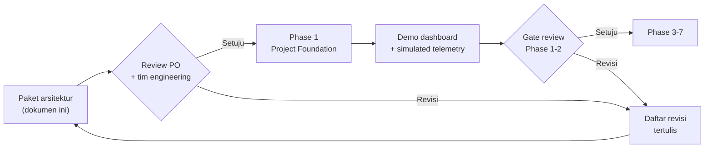

# 00 — Paket Arsitektur SUBAKO Web-PWA v0.1

**Untuk:** Product Owner, Mikiko Technology
**Dari:** Tim Engineering (Full-Stack, Backend, Frontend, UI/UX, Database, IoT, DevOps, QA & Security)
**Status:** Menunggu persetujuan (gate review Tahap B)

---

## 1. Maksud dokumen

Pasal 24 instruksi pengembangan menetapkan bahwa tahap pertama **tidak** langsung
membangun aplikasi, melainkan menyerahkan paket arsitektur untuk disetujui. Dokumen ini
adalah pintu masuk paket tersebut: apa yang diserahkan, bagaimana mereviewnya, apa yang
dianggap "disetujui", dan apa yang akan terjadi setelahnya.

Paket ini **tidak** mengunci keputusan hardware. Seluruh parameter mekanik, sensor, motor,
dan radio diperlakukan sebagai konfigurasi perangkat (*device capability*), sesuai
Pasal 22 butir 13.

---

## 2. Isi paket

| Deliverable | Dokumen | Inti yang perlu diputuskan reviewer |
|---|---|---|
| 1. System Architecture | `01-system-architecture.md` | Batas kepercayaan, alur uplink/downlink, mode SIMULATION vs LIVE, ADR |
| 2. Information Architecture | `02-information-architecture.md` | Struktur navigasi, peta URL, kepemilikan halaman per role |
| 3. User Flow | `03-user-flows.md` | 8 alur kritis termasuk command, rule lifecycle, ledger, offline |
| 4. High-Fidelity UI | `04-ui-design-system.md` + `design/` | Bahasa visual, design token, kontras aksesibilitas, state data |
| 5. Frontend Architecture | `05-frontend-architecture.md` | Struktur folder, state server, WebSocket, strategi PWA offline |
| 6. Backend Architecture | `06-backend-architecture.md` | Layering, ingestion, command service, ledger, audit |
| 7. Database ERD | `07-database-erd.md` | 40+ tabel, hypertable Telemetry, constraint & index |
| 8. API Specification | `08-api-specification.md` + `api/openapi.yaml` | Konvensi, katalog endpoint, contoh payload kritis |
| 9. RBAC Matrix | `09-rbac-matrix.md` | Permission code, site scoping, separation of duties |
| 10. Roadmap | `10-roadmap.md` | 7 fase, estimasi, urutan, risiko |

Pendukung: `11-keputusan-terbuka.md` — daftar keputusan yang **harus** diambil PO
sebelum atau selama implementasi.

---

## 3. Prinsip yang mengikat seluruh desain

Kelima prinsip berikut dipakai sebagai kriteria uji setiap keputusan arsitektur. Bila ada
usulan fitur yang melanggarnya, usulan ditolak — bukan dinegosiasikan di level UI.

1. **Tradition decides.** Tidak ada jalur di sistem yang dapat membuat, mengubah, atau
   memberlakukan hak distribusi air tanpa jejak Paruman dan persetujuan Pekaseh.
2. **Technology measures.** Angka yang ditampilkan adalah hasil pengukuran dengan
   *quality flag*, timestamp, dan sumber yang dapat ditelusuri. Tidak ada angka hasil
   interpolasi yang ditampilkan seolah-olah terukur.
3. **SUBAKO executes — bukan decides.** Eksekusi tunduk pada rule yang sudah disahkan,
   interlock perangkat, dan fail-safe lokal.
4. **Fail-safe by default.** Kehilangan server, jaringan, atau listrik tidak boleh
   menyebabkan perangkat bergerak. E-STOP fisik, limit switch, dan handwheel mekanis
   bekerja tanpa backend.
5. **Transparency is append-only.** Audit dan Water Ledger tidak dapat diubah diam-diam;
   koreksi dilakukan lewat entri kompensasi.

---

## 4. Ruang lingkup v0.1 (dan yang sengaja ditunda)

**Termasuk v0.1**

- Multi-site Subak dalam satu deployment, dengan site scoping pada level query.
- Telemetri melalui jalur IoT standar (ChirpStack → MQTT → Bridge → API).
- Water rule registry dengan versioning, approval, dan publish.
- Water Ledger append-only + verifikasi hash chain + ekspor.
- Command service dengan 9 lapis validasi, HMAC-SHA256, expiry, anti-replay.
- Device simulator untuk 6 skenario gangguan.
- PWA installable, offline shell, indikator stale — **tanpa** antrean command.
- Laporan harian/mingguan/bulanan + ekspor PDF/Excel.

**Ditunda (dengan alasan)**

| Ditunda | Alasan | Rencana |
|---|---|---|
| Otomasi AI/ML prediktif | v0.1 hanya butuh threshold + statistik dasar (Pasal 15) | Fase lanjutan setelah data lapangan ≥ 3 bulan |
| Push notification penuh (FCM/APNs) | Bergantung keputusan kanal (lihat `11-keputusan-terbuka.md` K-07) | v0.1: in-app + Web Push VAPID |
| Multi-tenant billing / langganan | Bukan kebutuhan pilot | Tidak dijadwalkan |
| Mobile native app | PWA sudah memenuhi kebutuhan lapangan | Dievaluasi pasca-pilot |
| Kontrol aktuasi dari peta (map click) | Risiko keselamatan; semua aktuasi harus lewat halaman gate + konfirmasi | Ditolak permanen untuk v0.1 |

---

## 5. Alur review yang diusulkan

**Aturan review:**

- Komentar ditulis per deliverable, bukan per kalimat, agar keputusan dapat dilacak.
- Setiap keputusan yang mengubah kontrak sistem dicatat sebagai ADR baru di
  `01-system-architecture.md` §11 dan diberi nomor.
- Keputusan yang belum bisa diambil **tidak menahan** Phase 1, selama dicatat di
  `11-keputusan-terbuka.md` dengan *default assumption* yang dipakai sementara.

---

## 6. Checklist sign-off

Centang bila setuju. Item yang tidak dicentang otomatis menjadi revisi.

**Arsitektur**

- [ ] Modular monolith (bukan microservices) untuk v0.1 dapat diterima.
- [ ] Satu pintu penulisan telemetri (Bridge → Internal Ingest API) disetujui.
- [ ] WebSocket + snapshot-on-connect sebagai mekanisme realtime disetujui.
- [ ] Pemisahan SIMULATION dan LIVE pada level data disetujui.

**Tata kelola air**

- [ ] Rule aktif immutable; perubahan = versi baru. Disetujui.
- [ ] Rule tidak dapat di-publish tanpa approval Pekaseh yang tercatat.
- [ ] Administrator teknis **tidak** memiliki otoritas menyetujui rule.

**Keselamatan**

- [ ] Prioritas state `FAULT > MANUAL > HOLD > AUTO > IDLE` diterapkan di backend dan firmware contract.
- [ ] PWA dilarang menyimpan/mengirim ulang command setelah offline.
- [ ] Command wajib lulus 9 lapis validasi sebelum dikirim.
- [ ] AI/anomaly detection tidak memiliki jalur ke command service.

**Data & kepatuhan**

- [ ] Hash chain (bukan blockchain) cukup untuk kebutuhan transparansi pilot.
- [ ] Retention time-series: raw 90 hari, 1 menit 13 bulan, 1 jam 5 tahun.
- [ ] Data pribadi anggota Subak disimpan minimal (nama, peran, kontak opsional).

**Desain**

- [ ] Palet warna dan tipografi pada `04-ui-design-system.md` sesuai brand.
- [ ] Bottom navigation mobile 5 item disetujui.
- [ ] Label `DEMO / SIMULATION` pada setiap tampilan data simulasi disetujui.

---

## 7. Definisi "disetujui"

Paket dianggap disetujui bila:

1. Checklist §6 ditandatangani (digital atau tertulis), **dan**
2. Tidak ada item `BLOCKING` pada `11-keputusan-terbuka.md` yang masih terbuka, **dan**
3. Product Owner menyatakan target tanggal untuk gate review Phase 1–2.

Setelah itu tim masuk ke Phase 1 dengan urutan kerja pada `10-roadmap.md` §4.

---

## 8. Yang tidak dibahas paket ini

- Skema kalibrasi sensor per titik ukur (butuh data lapangan; disediakan sebagai
  `calibration_records` yang dapat diisi saat commissioning).
- Perhitungan debit berdasarkan dimensi bangunan bagi (butuh survei; v0.1 memakai nilai
  terukur dari sensor, bukan estimasi geometri).
- Desain PCB, enclosure, dan firmware detail — di luar lingkup software, tetapi
  **kontrak payload** (`06-backend-architecture.md` §5) disiapkan agar firmware dapat
  mengikuti tanpa perubahan backend.
