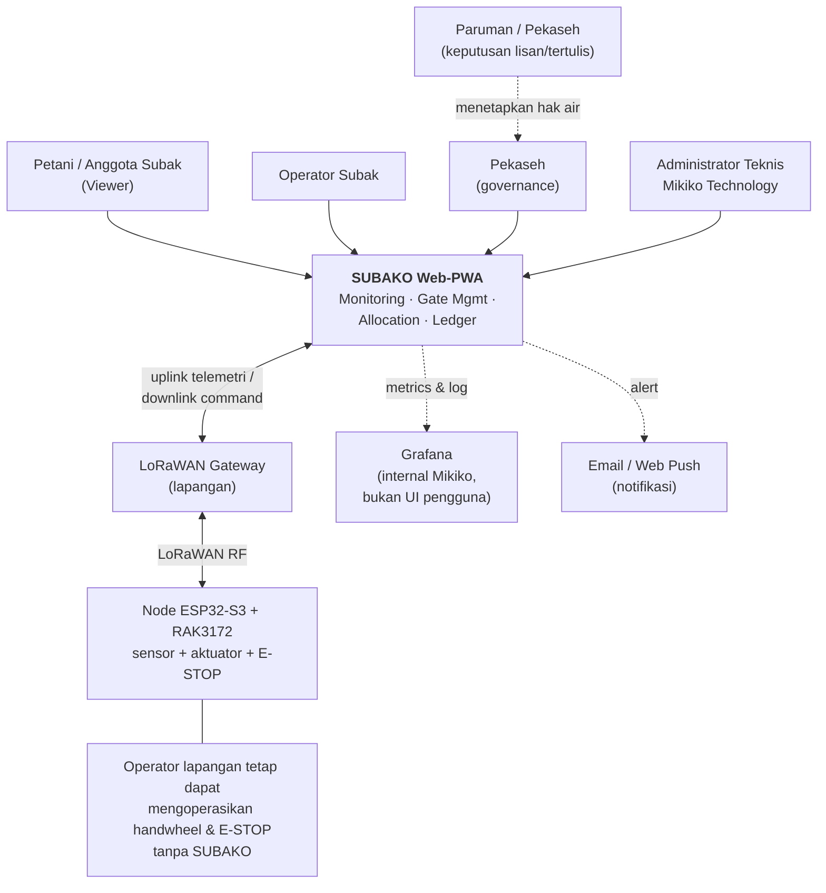
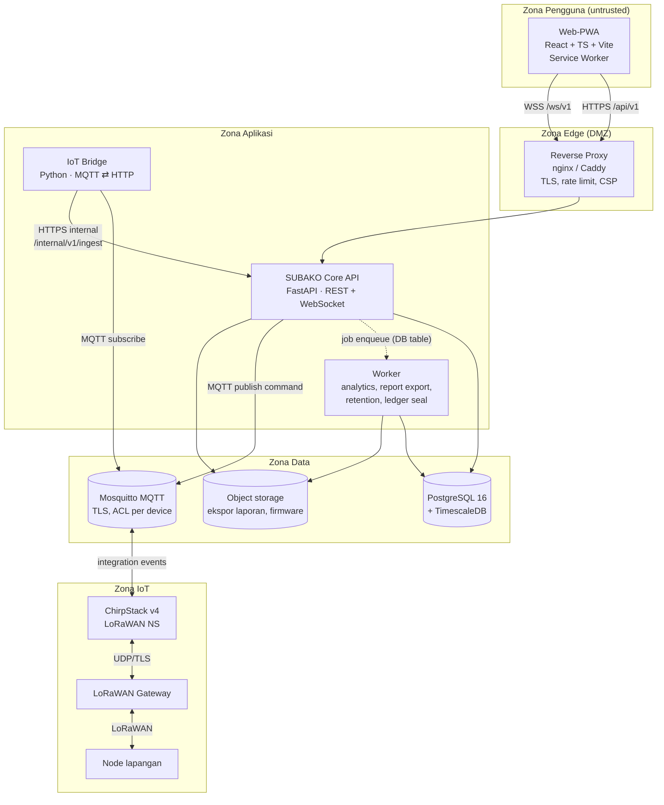
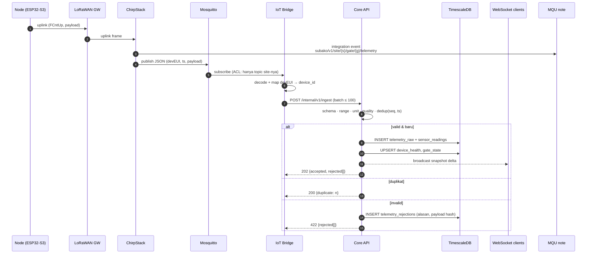
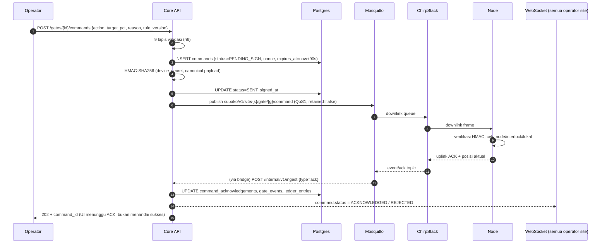
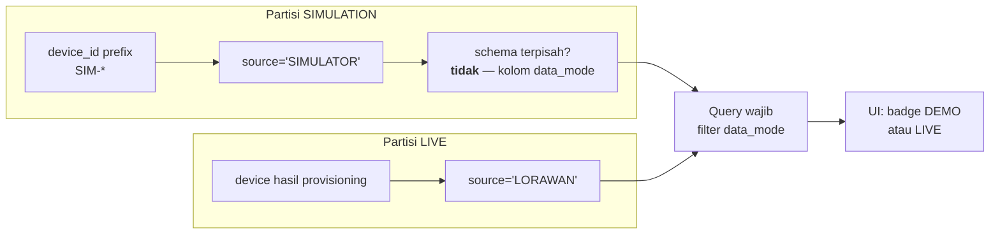
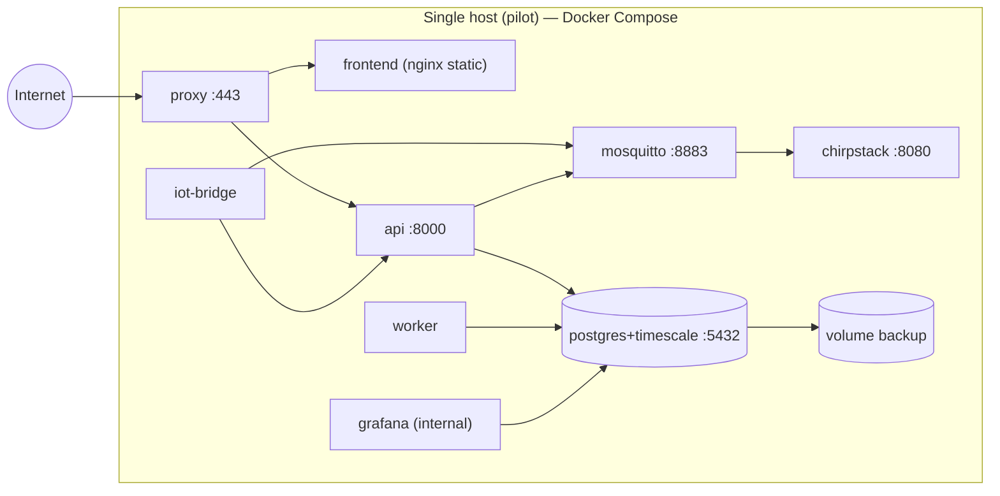

# 01 — System Architecture

**SUBAKO Web-PWA v0.1** · Mikiko Technology
Status: proposal untuk review · Zona waktu tampilan: WITA (UTC+8) · Penyimpanan: UTC

---

## 1. Prinsip arsitektur

| Prinsip | Konsekuensi konkret |
|---|---|
| Tradition decides | Otoritas rule terikat pada `meeting_references` (Paruman) + approval Pekaseh. Tidak ada endpoint yang mengubah rule aktif. |
| Technology measures | Setiap nilai sensor membawa `quality`, `ts`, `seq`, `source`. Nilai turunan (agregasi) ditandai `derived=true`. |
| SUBAKO executes | Eksekusi hanya untuk rule `PUBLISHED` yang valid + belum kedaluwarsa, dan hanya bila interlock mengizinkan. |
| Fail-safe | Tidak ada kontrol tertutup dari cloud. Perangkat menyelesaikan siklus gerak sendiri; cloud hanya memberi *intent* yang dibatasi. |
| Append-only transparency | Ledger & audit tidak punya jalur UPDATE/DELETE di application layer. |
| Boring technology | Stack stabil (FastAPI, PostgreSQL/TimescaleDB, React) — tim harus bisa merawatnya setelah serah terima. |

---

## 2. C4 Level 1 — System Context

**Aktor di luar sistem** yang tetap harus dihormati: Paruman (sumber otoritas),
dan kondisi fisik (handwheel, E-STOP) yang tidak boleh bergantung pada software.

---

## 3. C4 Level 2 — Container Diagram

### 3.1 Tanggung jawab container

| Container | Tanggung jawab | **Tidak** boleh |
|---|---|---|
| Web-PWA | Render, filter, form, validasi klien, WS client, cache shell | Menyimpan credential MQTT/device, menyimpan antrean command, menandatangani command |
| Reverse proxy | TLS, CSP, rate limit, kompresi, static asset | Logika bisnis |
| Core API | Auth, RBAC, domain logic, ingestion, command, ledger, WS fanout | Menyimpan secret device di plaintext, menulis langsung ke MQTT tanpa command service |
| Worker | Analytics batch, ekspor, seal harian, retention | Menerima request pengguna |
| IoT Bridge | Translasi MQTT ⇄ HTTP, normalisasi transport, dedup transport-level | Menulis langsung ke tabel domain, memutuskan otorisasi |
| Mosquitto | Broker, ACL topic per device | Retained message untuk topic `command` (dilarang) |
| ChirpStack | Network server, ADR, frame counter, join | Menjadi sumber kebenaran data aplikasi |
| PostgreSQL/Timescale | Sumber kebenaran | Menyimpan blob besar (pakai object storage) |

### 3.2 Keputusan: mengapa satu pintu ingest

Bridge **tidak** menulis ke database. Semua telemetri masuk melalui
`POST /internal/v1/ingest` (service-to-service, mTLS/token) sehingga:

- validasi Pydantic, range check, dan idempotency hanya ada di **satu** tempat;
- audit & WS fanout terjadi di transaksi yang sama;
- bridge dapat diganti (atau diganti ChirpStack HTTP integration) tanpa menyentuh skema.

Konsekuensi: API menjadi titik tunggal kegagalan untuk ingest → dimitigasi dengan
buffering di bridge (SQLite/disk queue, bounded) + `Retry-After` + backoff, dan
**bukan** dengan menulis langsung ke DB.

---

## 4. Batas kepercayaan (trust boundaries)

| Zona | Aktor/aset | Kontrol |
|---|---|---|
| Z1 Pengguna | Browser pengguna | TLS, JWT akses di memori, refresh di cookie `HttpOnly; Secure; SameSite=Strict`, CSP ketat |
| Z2 Edge | Reverse proxy | TLS terminasi, rate limit per IP & per user, WAF dasar, body size limit |
| Z3 Aplikasi | API, worker, bridge | Network internal, tanpa port publik kecuali proxy; secret via env/file 0600 |
| Z4 Data | Postgres, MQTT, object storage | Tanpa akses internet; user DB least-privilege; backup terenkripsi |
| Z5 IoT | ChirpStack, gateway, node | Device key per node; ACL topic; frame counter; **tidak ada** kredensial Z5 di Z1/Z2 |

Aturan lintas-zona yang tidak boleh dilanggar:

1. Z1 **tidak pernah** memegang kredensial Z3/Z4/Z5.
2. Z3 → Z5 hanya lewat command service (tidak ada publish MQTT ad-hoc dari endpoint lain).
3. Z2 tidak meneruskan header `X-Internal-*` dari luar; API menolak `/internal/*` yang bukan dari bridge.
4. Log Z3 tidak boleh memuat token, secret HMAC, atau payload mentah yang berisi PII.

---

## 5. Alur data

### 5.1 Uplink telemetri

**Freshness.** Setiap device punya `expected_interval_s` (default 60). Diturunkan oleh
API, bukan dihitung di browser:

- `LIVE` bila `now - ts ≤ 2×` interval
- `STALE` bila `2× < now - ts ≤ 5×`
- `OFFLINE` bila `> 5×` atau tidak ada heartbeat

Ambang dikirim di payload status sehingga PWA tidak perlu menebak (lihat
`08-api-specification.md` §6).

### 5.2 Downlink command

**Catatan kritis:** API hanya pernah melaporkan `SENT`, `ACKNOWLEDGED`, `REJECTED`,
`EXPIRED`, atau `UNKNOWN`. Status `EXECUTED` hanya diberikan bila telemetri
menunjukkan posisi aktual sesuai target dalam toleransi — bukan karena ACK.

### 5.3 Sequence kegagalan yang harus aman

| Kejadian | Perilaku sistem |
|---|---|
| Bridge mati | Telemetri berhenti → semua device jadi `STALE` lalu `OFFLINE` setelah ambang. UI menampilkan banner. Tidak ada command otomatis. |
| MQTT mati | Command gagal di tahap publish → status `FAILED_TO_SEND`, dicatat, tidak diretry otomatis. |
| API mati | PWA menampilkan state terakhir + timestamp; command ditolak (tidak ada antrean). |
| DB mati | API mengembalikan 503 dengan `Retry-After`; belum ada command yang dikirim (publish terjadi setelah commit). |
| ChirpStack mati | Gateway tetap menyimpan antrean LoRaWAN; setelah pulih, frame lama datang → ditolak bila `ts` lebih tua dari freshness atau `seq` sudah ada. |
| Listrik node hilang | Node kembali `IDLE`, tidak melanjutkan gerakan. Posisi dilaporkan ulang saat boot. |
| Server hilang total | Node tetap pada posisi terakhir; tidak ada gerakan otomatis. Handwheel & E-STOP tetap berfungsi. |

---

## 6. Validasi command — 9 lapis (ringkas)

1. **Authentication** — JWT valid, sesi aktif, bukan sesi yang di-revoke.
2. **Authorization** — permission `gate.command` dimiliki role.
3. **Site access** — `gate.site_id ∈ user_site_access(user)` dengan level ≥ `OPERATE`.
4. **Rule validity** — `rule_version` yang dirujuk `PUBLISHED`, belum `effective_to`,
   dan checksum cocok; command yang menyimpang dari rule butuh `override_reason` +
   permission `gate.command_override`.
5. **Command expiry** — `expires_at` di masa depan, `now < expires_at`, TTL ≤ 120 s.
6. **Device capability** — aksi ada di `device_capabilities`; `target_pct` dalam rentang.
7. **Device availability** — `device_health.state` bukan `OFFLINE`/`FAULT`, freshness
   `LIVE`, dan `reported_mode ∈ {AUTO, IDLE, HOLD}` untuk aksi otomatis.
8. **Duplicate/replay** — `nonce` unik global; `(device_id, seq)` belum dipakai;
   command identik dalam 60 s terakhir ditolak.
9. **State safety** — prioritas `FAULT > MANUAL > HOLD > AUTO > IDLE`; tidak ada
   command bila `MANUAL` atau `FAULT`; `HOLD` hanya boleh dilepas oleh role yang
   berwenang; limit switch `CLOSED` menolak `OPEN` bila interlock mengunci.

Detail implementasi: `06-backend-architecture.md` §6.

---

## 7. Mode SIMULATION vs LIVE

Simulasi bukan flag UI, melainkan **partisi data**:

Aturan:

- Kolom `data_mode ∈ {SIMULATION, LIVE}` ada di `sites`, `devices`, `sensor_readings`,
  `ledger_entries`, `alerts`, dan `reports` — bukan hanya di frontend.
- Site punya `data_mode`; device mewarisi dan tidak boleh mencampur dalam satu site.
- API menolak command lintas mode (`409 MODE_CONFLICT`).
- `LIVE` dinonaktifkan default: site baru `status=PROVISIONING`,
  `data_mode=SIMULATION` sampai commissioning selesai.
- Endpoint `/admin/system-health` menampilkan jumlah device per mode untuk audit.

---

## 8. Non-functional requirements (target v0.1)

| Aspek | Target | Cara ukur |
|---|---|---|
| Ingest → WS terlihat di UI | p95 < 3 s | timestamp ingest vs WS frame (dev tooling) |
| REST list endpoint | p95 < 300 ms @ 50k readings/site/hari | pytest-benchmark / locust |
| Riwayat 24 jam (1 gate) | < 800 ms | query plan + test |
| Ekspor 30 hari | < 15 s (async job, unduh via signed URL) | test worker |
| Uptime pilot | 99% per bulan (single-node compose) | healthcheck + log |
| RPO | ≤ 5 menit (WAL archiving) | simulasi restore |
| RTO | ≤ 2 jam | drill backup/restore |
| Freshness deteksi | ≤ 1 siklus setelah ambang | test stale |
| Retensi raw | 90 hari di hypertable, lalu agregat | retention policy test |
| Retensi agregat 1 menit | 13 bulan | konfigurasi Timescale |
| Retensi agregat 1 jam | 5 tahun | konfigurasi Timescale |
| Aksesibilitas UI | WCAG 2.1 AA pada teks & kontrol | audit kontras (lihat `04`) |

Beban acuan pilot: 3 site · 12 gate · 24 node ukur · interval 60 s ≈ 3.100 reading/jam.

---

## 9. Topologi deployment

- **Development:** `compose.dev.yml` — hot reload, Postgres tanpa TLS, Mosquitto tanpa
  TLS, ChirpStack opsional (bridge punya mode `--simulate`).
- **Staging/Pilot:** `compose.yml` + `.env.staging`, TLS wajib, ChirpStack wajib,
  backup harian.
- **Production:** sama seperti staging dengan resource limit, WAL archiving ke
  object storage, dan monitoring eksternal.
- Satu host untuk pilot (12 node) cukup; scale-out path didokumentasikan
  (`06-backend-architecture.md` §11) tetapi **tidak** diimplementasikan di v0.1.

---

## 10. Observability

| Lapisan | Alat | Yang dilihat |
|---|---|---|
| Log aplikasi | JSON structured (structlog) + request_id | Error, penolakan command, ingest reject |
| Metrics | Prometheus (`/metrics`, internal) | ingest rate, reject rate, WS clients, command latency, queue depth |
| Dashboard internal | Grafana | Kesehatan sistem untuk Mikiko |
| Audit bisnis | tabel `audit_events` | Siapa melakukan apa, kapan, dari mana |
| Health | `/healthz` (liveness), `/readyz` (DB+MQTT) | Compose healthcheck & proxy upstream check |

Grafana **bukan** antarmuka pengguna SUBAKO dan tidak diekspos ke internet.

---

## 11. Architecture Decision Records (ringkasan)

| ID | Keputusan | Alasan | Alternatif yang ditolak |
|---|---|---|---|
| ADR-001 | Modular monolith (satu API + satu worker) | Tim kecil, domain masih berubah, deploy sederhana | Microservices (biaya operasional tidak sepadan) |
| ADR-002 | Satu pintu ingest lewat Core API | Validasi & audit tunggal, mudah ganti transport | Bridge menulis DB langsung |
| ADR-003 | Event bus in-process + tabel `outbox` di DB | Cukup untuk 1 instance; tidak menambah Redis | Redis Streams (ditunda sampai >1 API instance) |
| ADR-004 | TimescaleDB hypertable + continuous aggregate | Query histori cepat, retention native | Tabel biasa + cron agregasi manual |
| ADR-005 | Access token 15 mnt (memori) + refresh token rotasi (cookie HttpOnly) | XSS-resistant, logout bisa di-revoke | Token di localStorage (ditolak) |
| ADR-006 | Ledger = hash chain + append-only tabel, **bukan** blockchain | Cukup untuk audit trail, biaya rendah, dapat diverifikasi | Blockchain (kompleksitas & klaim berlebihan) |
| ADR-007 | HMAC-SHA256 per device; secret di secret store; signing di server | Kontrak firmware existing | Signing di browser (ditolak keras) |
| ADR-008 | PWA dilarang mengantre command | Keselamatan: command basi bisa mematikan/merusak | Background Sync untuk command (ditolak) |
| ADR-009 | Tailwind + CSS custom properties untuk token | Konsistensi, mudah rebrand | CSS-in-JS (bundle lebih besar) |
| ADR-010 | ChirpStack MQTT integration → topic SUBAKO | Tidak mengunci ke satu vendor NS | Integrasi gRPC langsung (rapuh antar versi) |
| ADR-011 | Same-origin `/api/v1` di belakang proxy | Tidak perlu CORS, cookie aman | API subdomain terpisah |
| ADR-012 | Freshness dihitung backend, dikirim ke klien | Satu sumber kebenaran waktu | Menghitung di browser (clock skew) |
| ADR-013 | Rule immutable + versi baru | Jejak audit & Paruman dapat dipertahankan | Edit in-place dengan histori |
| ADR-014 | `data_mode` sebagai kolom, bukan environment terpisah | Demo & pilot pada deployment sama tanpa risiko tercampur | Dua deployment terpisah (mahal untuk pilot) |

Perubahan atas ADR mana pun wajib menambah entri baru (tidak menghapus yang lama).

---

## 12. Di luar lingkup v0.1

- Kontrol adaptif berbasis ML dan optimasi distribusi otomatis.
- Integrasi pembayaran/pungutan (pecatu, seka).
- Aplikasi mobile native.
- Multi-region / HA cluster.
- Integrasi GIS pihak ketiga (peta memakai GeoJSON site + tile standar).
