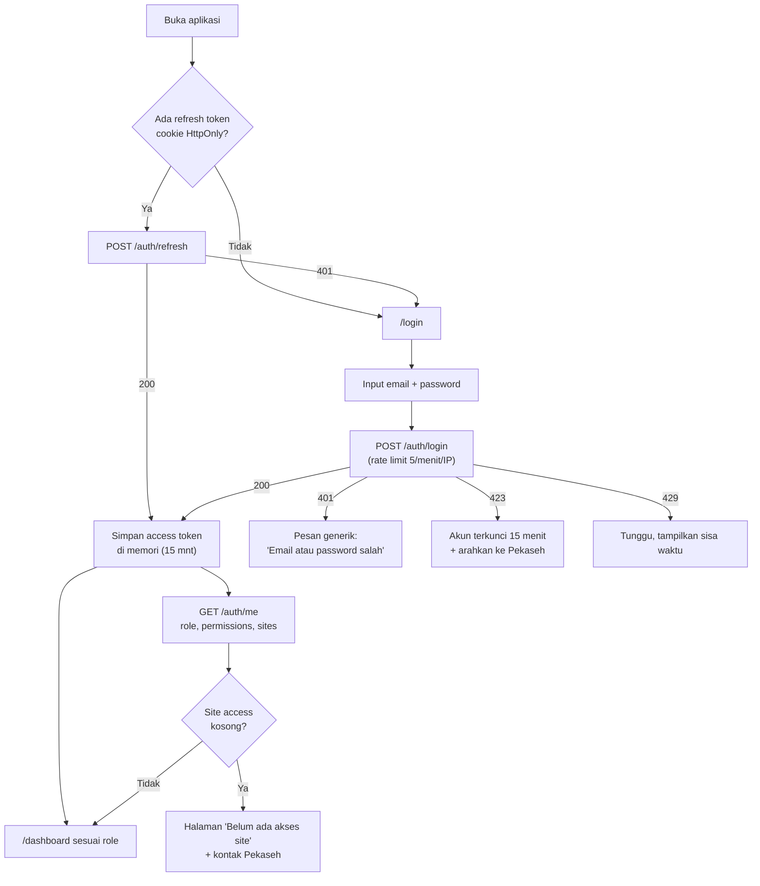
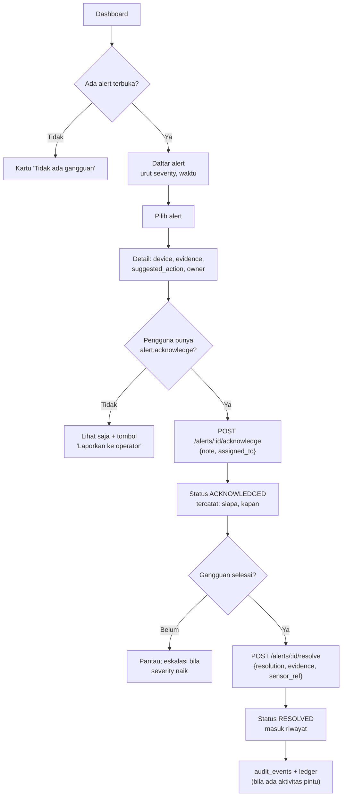
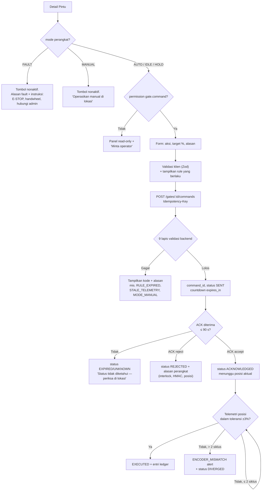
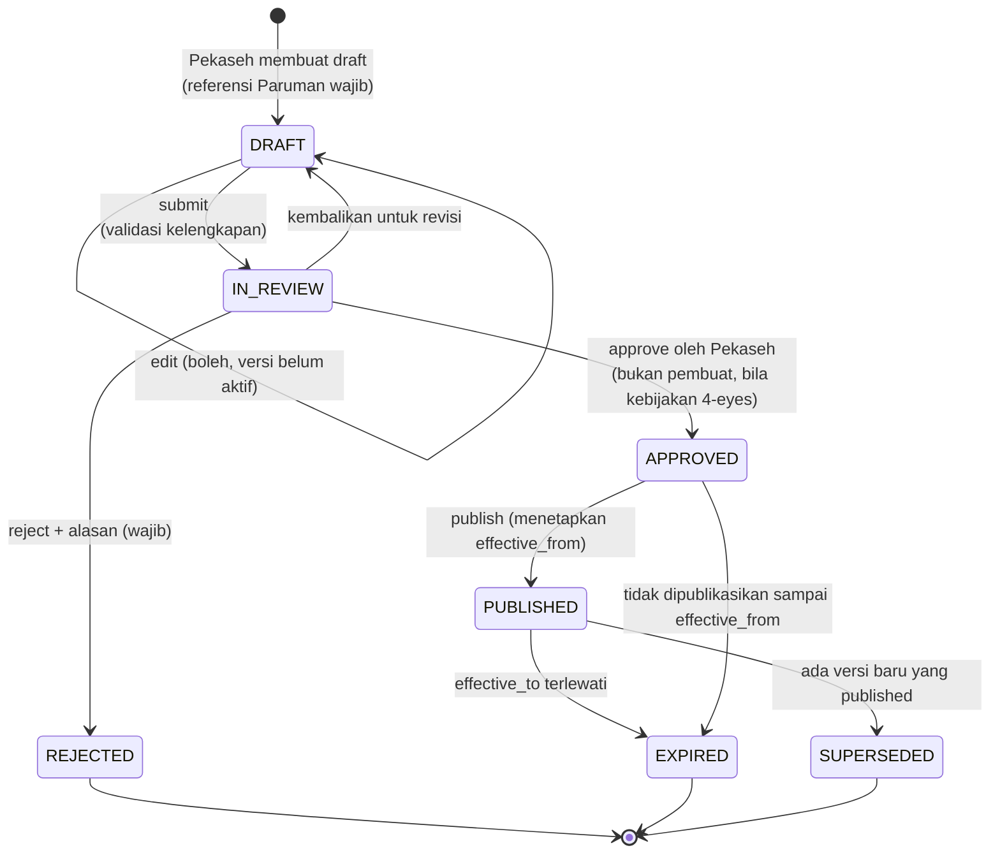
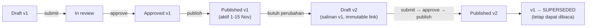
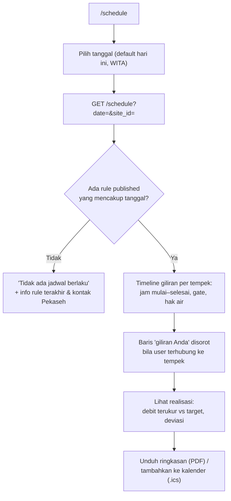
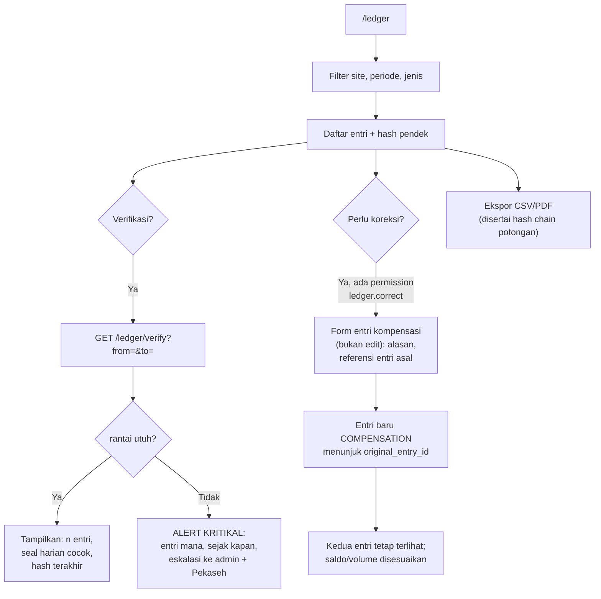
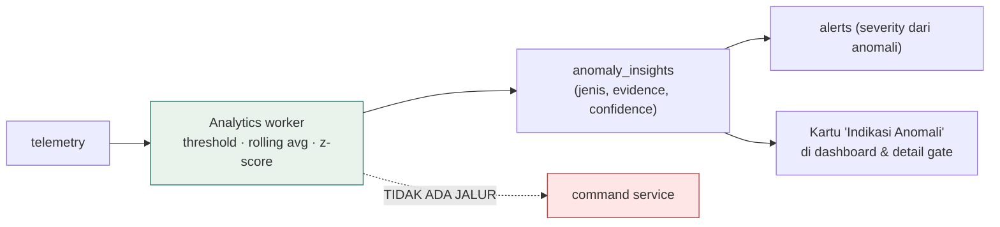
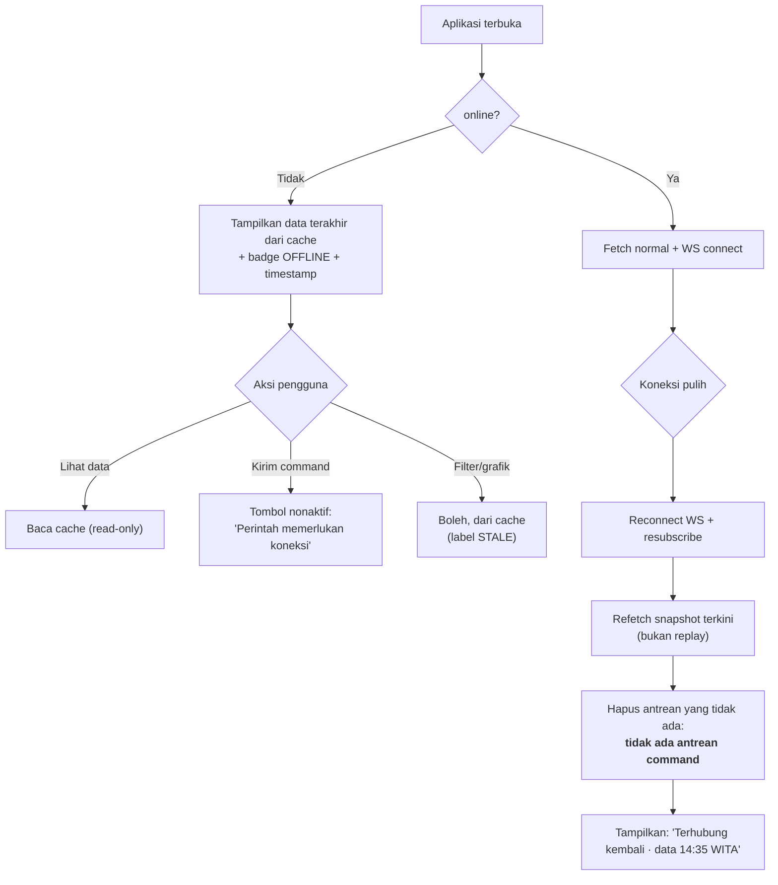
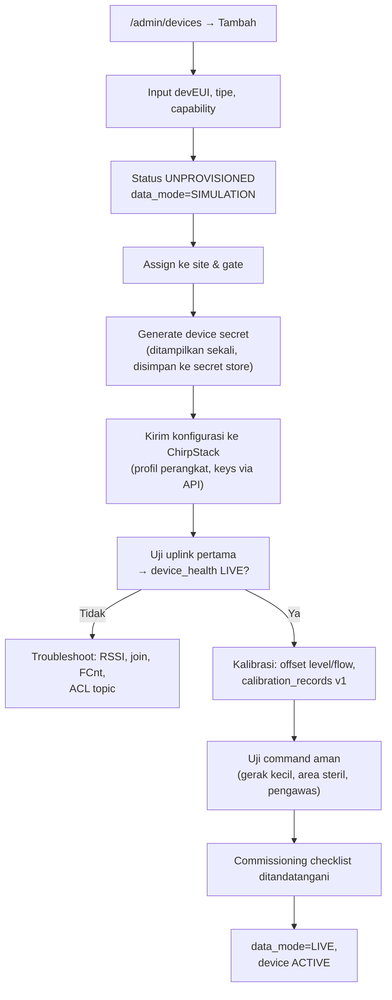

# 03 — User Flow Diagram

**SUBAKO Web-PWA v0.1** · Alur kritis yang menentukan keputusan arsitektur

Delapan alur di bawah dipilih karena masing-masing memiliki titik keputusan yang, bila
salah, berakibat pada keselamatan, keabsahan tata kelola, atau integritas catatan.

---

## 1. Login & sesi

Aturan:

- Password salah tidak pernah menyebut apakah email terdaftar.
- Setelah 5 kegagalan, akun `locked_until = now + 15 mnt` dan dicatat di `audit_events`.
- Access token tidak pernah masuk `localStorage`/`sessionStorage`.
- Idle 30 menit → sesi berakhir (refresh token di-revoke), PWA menampilkan layar kunci.

---

## 2. Dashboard → alert → acknowledge → resolve

Catatan: alert otomatis tidak pernah menutup dirinya sendiri tanpa bukti pemulihan
(telemetri baru dengan quality `OK` selama ≥ 2 siklus), dan **tidak pernah** memicu
command. Lihat §7 di bawah untuk batas AI.

---

## 3. Command aktuasi pintu (paling kritis)

Aturan yang tidak boleh dilanggar:

- Tombol **tidak** pernah menampilkan "berhasil" sebelum `EXECUTED`.
- Tidak ada tombol "coba lagi" untuk command `EXPIRED`/`UNKNOWN`; pengguna harus
  membuat command baru (yang berarti validasi ulang penuh).
- Tidak ada aksi dari peta, dari notifikasi, atau dari bulk action.

---

## 4. Siklus hidup aturan air (governance)

Aturan:

- Setiap perubahan = record baru di `water_rule_versions` dengan `version_no + 1`.
- `PUT`/`PATCH` pada rule `PUBLISHED` ditolak `409 RULE_IMMUTABLE`.
- Publish menolak bila: tidak ada approval valid, `effective_from` di masa lalu,
  entitlement total > 100% (bila mode proporsi), atau gate target tidak ada di site.
- Profil pemisahan tugas: pembuat rule **tidak** dapat menyetujui rule-nya sendiri
  bila `separation_of_duties=true` (default untuk pilot, dapat dimatikan PO).

---

## 5. Jadwal distribusi (sudut pandang Petani)

---

## 6. Water Ledger: verifikasi & koreksi

Aturan: tidak ada endpoint `PATCH /ledger/:id` dan tidak ada `DELETE`.
Entri kompensasi wajib punya `reason` ≥ 20 karakter dan `original_entry_id`.

---

## 7. Batas AI/anomalytics (advisory-only)

Kontrol arsitektural: modul `analytics` tidak mengimpor `command_service` (dijaga oleh
import-linter di CI). Rekomendasi anomali hanya menyentuh tabel `alerts` dan
`anomaly_insights`; keduanya tidak dibaca oleh jalur eksekusi command.

---

## 8. Offline & pemulihan koneksi (PWA)

Hal yang **tidak** terjadi saat kembali online: pengiriman ulang command, replay
mutasi, atau penanda "berhasil" pada aksi yang tidak pernah terkirim.

---

## 9. Provisioning & commissioning perangkat (Admin)

Verifikasi fisik (E-STOP, limit switch, handwheel) adalah **prasyarat** dan bukan bagian
dari alur software; hasilnya dicatat sebagai `commissioning_records` + audit.
