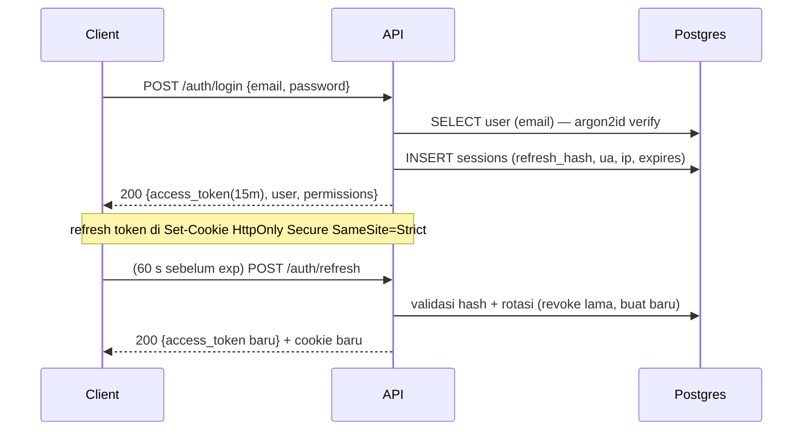
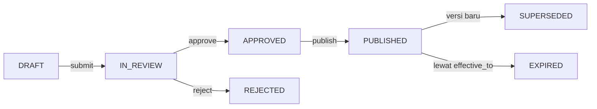

# 06 — Backend Architecture

**SUBAKO Web-PWA v0.1** · FastAPI + SQLAlchemy 2.0 async + PostgreSQL/TimescaleDB

---

## 1. Bentuk arsitektur

**Modular monolith** dengan batas modul yang tegas (ADR-001). Satu proses API, satu
proses worker, satu proses bridge. Setiap modul domain memiliki router, service,
repository, dan skema sendiri; tidak ada modul yang menyentuh tabel modul lain secara
langsung.

```text
backend/app/
├── main.py                  # create_app(), middleware, router registry
├── core/
│   ├── config.py            # Settings (pydantic-settings), 12-factor
│   ├── security.py          # JWT, password hash (argon2id), HMAC helpers
│   ├── deps.py              # get_current_user, require(permission), get_site_scope
│   ├── errors.py            # AppError + handler → Problem Details
│   ├── logging.py           # structlog JSON, request_id, redaction filter
│   ├── time.py              # UTC helpers, WITA conversion (display only)
│   └── pagination.py        # cursor encode/decode
├── db/
│   ├── session.py           # async engine, session factory, transaction helper
│   ├── base.py              # DeclarativeBase, TimestampMixin, UUIDMixin
│   └── migrations/          # Alembic (satu head, autogenerate dilarang di prod)
├── modules/
│   ├── identity/            # users, roles, permissions, sessions, auth
│   ├── sites/               # sites, subaks, tempeks, channels, members
│   ├── devices/             # devices, gateways, capabilities, firmware, calibration
│   ├── telemetry/           # ingest, readings, health, freshness, aggregates
│   ├── gates/               # gate state, events, commands, acknowledgements
│   ├── rules/               # water rules, versions, approvals, entitlements, schedules
│   ├── ledger/              # entries, seals, verification, export
│   ├── alerts/              # alerts, ack, resolution, notifications
│   ├── reports/             # query builders + export jobs
│   ├── analytics/           # thresholds, rolling stats, anomaly insights (advisory)
│   ├── audit/               # audit_events writer + query
│   └── admin/               # system health, user management, provisioning
├── realtime/
│   ├── manager.py           # ConnectionManager (channels, fanout, snapshot)
│   └── events.py            # event schema (type, seq, ts, payload)
├── integrations/
│   ├── mqtt.py              # paho-mqtt client wrapper (publish command, subscribe ack)
│   ├── chirpstack.py        # optional REST client (device provisioning)
│   └── secrets.py           # secret store abstraction (env/file/vault)
├── workers/
│   ├── runner.py            # polling loop on job table (SKIP LOCKED)
│   ├── jobs/                # ledger_seal, report_export, retention, anomaly_scan
│   └── scheduler.py         # interval + cron-like schedule
└── tests/
```

**Aturan dependensi (dijaga `import-linter` di CI):**

1. `modules/*` tidak boleh mengimpor `modules/*` lain secara langsung — gunakan
   `core/ports.py` (protocol) atau service publik modul (mis. `telemetry.public`).
   Pengecualian terdokumentasi: `ledger` boleh memanggil `gates.read_state()`.
2. `modules/analytics` **dilarang** mengimpor `modules/gates.command_service`
   (memastikan AI tidak dapat memicu aktuasi — kontrol arsitektural, bukan disiplin).
3. `integrations/*` tidak boleh mengimpor `modules/*`; arah sebaliknya diperbolehkan
   lewat interface.
4. `realtime` menerima event dari service, tidak membaca DB sendiri.

---

## 2. Lapisan & tanggung jawab

| Lapisan | Boleh | Tidak boleh |
|---|---|---|
| Router | Params, dependency auth, panggil service, serialisasi response | Query SQL, logika bisnis |
| Service | Aturan bisnis, transaksi, audit, event emit | SQLAlchemy `select()` langsung (pakai repo) |
| Repository | Query, filter site scope, pagination | Keputusan otorisasi |
| Model | Kolom, constraint, relasi | Logika lintas entitas |
| Schema (Pydantic) | Validasi bentuk, koersi, dokumen OpenAPI | Query DB |

Semua endpoint menulis lewat service; read boleh langsung ke repo dengan filter site
yang diwajibkan oleh `get_site_scope()`.

---

## 3. Kontrak waktu, satuan, identifier

| Aspek | Aturan |
|---|---|
| Waktu | `timestamptz`, selalu UTC. WITA hanya di UI/ekspor (dengan label zona). |
| ID | UUIDv7 (time-ordered) untuk tabel transaksional; `bigserial` untuk hypertable readings (lebih murah, tapi tetap punya `reading_id uuid` untuk referensi eksternal). |
| Satuan | meter (level), liter/detik (flow), persen (bukaan, baterai), volt, dBm, dB, ampere. |
| Angka | `numeric(10,4)` untuk level & flow, `numeric(6,2)` untuk persen, bukan float. |
| Enumerasi | PostgreSQL `ENUM` untuk status inti (stabil) + `CHECK` untuk yang masih berkembang. |
| Soft delete | Hanya `users.is_active`, `devices.is_active`, `sites.is_active`. Historis tidak dihapus. |

---

## 4. Autentikasi & sesi



- Password: **argon2id** (`time_cost=2`, `memory_cost=64MiB`, `parallelism=2`).
- Refresh token: opaque 256-bit, disimpan sebagai SHA-256 di `sessions.refresh_hash`;
  rotasi setiap refresh; deteksi reuse → revoke seluruh sesi user + audit `TOKEN_REUSE`.
- JWT: `HS256`/`EdDSA` (pilihan Phase 1), klaim `sub`, `sid`, `role`, `perms_hash`, `iat`,
  `exp`, `jti`. Permission penuh diambil dari DB per request (cache 30 s in-process)
  agar pencabutan hak berlaku cepat; `perms_hash` dipakai untuk mendeteksi cache basi.
- Rate limit login: 5/menit/IP + 10/jam/akun; lockout 15 menit.
- `POST /auth/ws-ticket`: ticket sekali pakai, TTL 30 s, disimpan di memori + tabel
  untuk multi-instance nanti.

---

## 5. Ingestion telemetri

### 5.1 Pipeline

```text
bridge HTTP → [1 validasi skema] → [2 range & satuan] → [3 dedup]
            → [4 quality flag] → [5 persist raw+normalized] → [6 derive state]
            → [7 event outbox] → [8 WS fanout] → [9 alert evaluation]
```

| Tahap | Detail | Kegagalan |
|---|---|---|
| 1 Skema | Pydantic `TelemetryIn`: wajib `device_id, ts, seq, mode`; opsional semua sensor | 422, dicatat `telemetry_rejections` |
| 2 Range | level 0–10 m, flow 0–500 L/s, bukaan 0–100, baterai 0–100, RSSI −140…0, arus 0–10 A | Tolak nilai di luar → `OUT_OF_RANGE`, bukan clamp |
| 3 Dedup | Unique `(device_id, seq)`; juga tolak `ts` lebih tua dari `now - 24 h` | `duplicate` dihitung, tidak error |
| 4 Quality | `OK / SUSPECT / BAD / MISSING` per channel dari payload + aturan server | `BAD` tetap disimpan (untuk audit) tetapi tidak dipakai agregasi |
| 5 Persist | `telemetry_raw` (jsonb mentah) + `sensor_readings` (baris per channel) | Transaksi tunggal per batch |
| 6 Derived | `device_health` upsert, `gate_state` upsert, `sites` counter | Idempotent upsert |
| 7 Outbox | `outbox_events` untuk fanout lintas proses | Worker mengirim ulang maks 3× |
| 8 WS | Fanout ke kanal site | Gagal WS tidak menggagalkan ingest |
| 9 Alerts | Evaluasi aturan threshold (in-process, < 5 ms) | Alert dibuat idempotent per `(rule, device, window)` |

### 5.2 Idempotency

- **Ingest:** unique index `(device_id, seq)` → `ON CONFLICT DO NOTHING`; respons
  menyertakan `accepted`/`duplicate`.
- **Command POST:** header `Idempotency-Key` wajib; disimpan `(key, user_id, request_hash)`
  selama 24 jam. Key sama + body sama → kembalikan hasil sebelumnya. Key sama + body
  beda → `409 IDEMPOTENCY_MISMATCH`.
- **Ledger:** `entry_hash` unik; insert gagal bila duplikat → tidak ada entri ganda.
- **Ekspor laporan:** idempotent per `(report_type, params_hash, requested_by_hour)`.

### 5.3 DTO minimum yang diterima (kontrak firmware)

```json
{
  "device_id": "subako-gate-01",
  "ts": "2026-09-14T02:15:00Z",
  "seq": 3812,
  "mode": "AUTO",
  "rule_id": "SUBAK-AIR-021",
  "water_level_m": 0.82,
  "flow_lps": 37.6,
  "gate_position_pct": 34.0,
  "battery_pct": 87,
  "battery_v": 3.98,
  "rssi_dbm": -71,
  "snr_db": 8.5,
  "motor_current_a": 1.24,
  "limit_closed": false,
  "limit_open": false,
  "estop": false,
  "firmware": "0.9.3",
  "quality": { "level": "OK", "flow": "OK", "encoder": "OK" }
}
```

Aturan kompatibilitas: field baru **additive** dan opsional; backend tidak pernah
mensyaratkan field yang belum ada di baseline firmware. Skema versi dinyatakan di
`telemetry_schema_version` (default `1`) sehingga perubahan besar dapat dideteksi.

---

## 6. Command service

### 6.1 Model status

```text
created → VALIDATED → SIGNED → SENT → ACKNOWLEDGED → EXECUTED
                              ↘ REJECTED (perangkat menolak)
                              ↘ EXPIRED (tidak ada ACK sebelum expires_at)
                              ↘ FAILED_TO_SEND (broker error)
                              ↘ UNKNOWN (ACK hilang / tidak dapat dipastikan)
```

`EXECUTED` hanya bila telemetri posisi ∈ `target ± 3%` dalam ≤ 2 siklus; jika tidak,
status `DIVERGED` + alert `ENCODER_MISMATCH`.

### 6.2 Payload yang ditandatangani

```json
{
  "cmd": "SET_POSITION",
  "gate_id": "b7f1...",
  "target_pct": 40.0,
  "rule_id": "SUBAK-AIR-021",
  "rule_version": 3,
  "rule_checksum": "sha256:9f2c…",
  "issued_at": "2026-10-30T03:12:00Z",
  "expires_at": "2026-10-30T03:13:30Z",
  "nonce": "8f3a1c0e-…",
  "actor": "user:1f0c…",
  "seq": 1204
}
```

Tanda tangan: `HMAC-SHA256(device_secret, canonical_json(payload))` di mana
`canonical_json` = urutkan key leksikografis, tanpa spasi, UTF-8, angka tanpa trailing
zero. Ditambahkan sebagai `sig` (hex). Firmware memverifikasi dengan secret per device.

### 6.3 Penyimpanan & pengiriman

- Secret device: `secrets` abstraction; default pilot = file terenkripsi (age/sops) yang
  dibaca saat start, atau Docker secret. **Tidak pernah** dikirim ke klien, tidak masuk
  log, tidak ada di repo.
- Ingin tahu apakah publish sukses sebelum status `SENT`: publish QoS1 dengan timeout
  3 s, setelah commit DB (`SENT` disimpan lebih dulu sebagai `PENDING_SIGN`; bila publish
  gagal → `FAILED_TO_SEND`).
- Retained message untuk topik `command` **dimatikan** pada level broker (Mosquitto
  `retain_available` + ACL deny); API tidak pernah set `retain=true`.
- Maksimum command per gate: 1 aktif. Command baru menolak bila ada yang `SENT` dan
  belum kedaluwarsa (`409 COMMAND_IN_FLIGHT`).

### 6.4 Perangkat menolak

Node mengirim ACK `{status:"REJECTED", reason:"INTERLOCK_LIMIT" | "MODE_MANUAL" |
"HMAC_INVALID" | "TARGET_OUT_OF_RANGE" | "ESTOP"}`. API mencatat `command_acknowledgements`,
membuat `gate_events`, dan menaikkan alert untuk `HMAC_INVALID` (indikasi kunci salah
atau upaya replay).

---

## 7. Rule service & lifecycle



Invarian yang diuji di service **dan** di database:

1. Tidak ada `UPDATE` pada baris `water_rule_versions` yang sudah pernah `PUBLISHED`
   (trigger `raise exception` bila `OLD.status IN ('PUBLISHED','SUPERSEDED','EXPIRED')`).
   Perubahan = insert versi baru.
2. `publish` memerlukan minimal satu baris `rule_approvals` valid dengan
   `approver_id <> created_by` bila `sites.separation_of_duties = true`.
3. Publish menolak bila `effective_from::date < today` (WITA) dan
   `sum(entitlement_pct) > 100.00` untuk mode `PROPORTIONAL`.
4. Rule terhubung ke `meeting_references` (nomor/tanggal Paruman + dokumen opsional).
   Tanpa referensi, submit ditolak `422 MEETING_REFERENCE_REQUIRED`.
5. `rule_checksum` = SHA-256 atas isi versi yang dibekukan; dipakai command dan ledger
   agar dapat dibuktikan rule mana yang dieksekusi.

---

## 8. Water Ledger

### 8.1 Struktur hash chain

```text
prev_hash  = entry_hash dari entri sebelumnya (per site, urut id)
entry_hash = SHA256(canonical_json({
  site_id, seq, type, occurred_at, gate_id, rule_version_id,
  entitlement, volume_m3, position_before, position_after,
  actor_type, actor_id, ref_reading_ids, prev_hash
}))
```

- `seq` per site, tanpa lompatan (dijaga unique `(site_id, seq)` + transaksi
  `SELECT ... FOR UPDATE` pada counter site).
- `ledger_daily_seals`: pada 00:05 WITA, worker menghitung `merkle_root` dari hash hari
  sebelumnya, menyimpan `seal_hash = SHA256(last_entry_hash || merkle_root || date)`.
  Seal adalah bukti ringkas untuk laporan/ekspor.
- `ledger_verification`: setiap verifikasi manual menyimpan hasil (rentang, jumlah,
  status, durasi) agar dapat diaudit siapa memverifikasi kapan.

### 8.2 Koreksi

Tidak ada UPDATE/DELETE. Koreksi = entri baru bertipe `COMPENSATION` dengan
`original_entry_id`, `reason`, dan nilai volume negatif/penyesuaian. UI menampilkan
keduanya berpasangan.

### 8.3 Verifikasi

`GET /api/v1/ledger/verify?site_id&from&to` menghitung ulang rantai dan membandingkan
dengan seal harian. Respons memuat `entries_checked`, `first_broken_seq`, `status`.

---

## 9. RBAC enforcement

Tiga lapis, semuanya di server:

```python
# 1. Route-level permission
@router.post("/gates/{gate_id}/commands", dependencies=[Depends(require("gate.command"))])

# 2. Object-level site scope
gate = await gate_service.get_or_404(gate_id)
scope.require(gate.site_id, level="OPERATE")   # 403 bila tidak ada akses

# 3. Business-rule guard di service
if state.mode in ("MANUAL", "FAULT"): raise AppError("MODE_BLOCKED", 409, ...)
```

`SiteScope` dimuat sekali per request (`user_site_access`), berisi `site_id → level`
(`VIEW | OPERATE | GOVERN | ADMIN`). Repository **wajib** menerima `scope` dan
menerapkannya sebagai `WHERE site_id = ANY(...)`. Query tanpa scope gagal di review
(checklist PR) dan ditandai oleh test khusus "no unscoped query".

---

## 10. Audit

- Ditulis oleh service, bukan middleware generik, agar memuat konteks domain
  (`before/after` ringkas, bukan seluruh baris).
- Tabel `audit_events`: `id, occurred_at, actor_type, actor_id, actor_role, site_id,
  action, entity_type, entity_id, summary, diff jsonb, request_id, ip, user_agent`.
- Append-only: tidak ada endpoint update/delete; trigger menolak `UPDATE`/`DELETE`.
- Aksi yang wajib diaudit: login/logout/failed-login, perubahan user & role, pembuatan/
  submit/approve/publish rule, command (semua status), override, provisioning,
  kalibrasi, perubahan konfigurasi sistem, ekspor ledger/laporan, verifikasi ledger.

---

## 11. Worker & job

Job disimpan di tabel `jobs` (`type`, `payload`, `run_at`, `attempts`, `locked_by`),
diklaim dengan `SELECT ... FOR UPDATE SKIP LOCKED`. Tidak memakai Celery/Redis di v0.1
(ADR-003).

| Job | Jadwal | Catatan |
|---|---|---|
| `ledger_seal` | harian 00:05 WITA | per site, idempotent |
| `report_export` | on-demand | simpan file ke object storage, signed URL 15 mnt |
| `retention` | harian 02:00 WITA | drop chunk > 90 hari, hapus rejection > 180 hari |
| `anomaly_scan` | tiap 5 menit | tulis `anomaly_insights`, tidak pernah command |
| `freshness_scan` | tiap 30 detik | set `device_health.state = STALE/OFFLINE` |
| `notification_dispatch` | tiap 30 detik | Web Push/email untuk alert baru |
| `session_cleanup` | tiap jam | hapus sesi kedaluwarsa |

---

## 12. Observability & operasi

| Endpoint | Isi |
|---|---|
| `GET /healthz` | 200 selama proses hidup (tanpa dependensi) |
| `GET /readyz` | cek DB (`SELECT 1`), MQTT connected, disk > 10% |
| `GET /metrics` | Prometheus (internal only) |
| `GET /api/v1/admin/system-health` | ringkasan untuk admin teknis (ingest/jam, reject rate, WS clients, job backlog, freshness distribution, DB size) |

Log: satu baris JSON per request (`request_id`, `method`, `path`, `status`, `dur_ms`,
`user_id` bila ada, `site_id`). Filter redaksi menghapus `authorization`, `cookie`,
`sig`, `secret`, `password`.

---

## 13. Testing backend

| Area | Tes wajib |
|---|---|
| Auth | login sukses/gagal, lockout, refresh rotasi, reuse detection, logout revoke |
| RBAC | matrix role × endpoint (parametrized dari `09-rbac-matrix.md`), site isolation (user A tidak bisa baca site B) |
| Ingest | valid, duplikat seq, payload invalid, out-of-range, timestamp basi, quality BAD, batch sebagian gagal |
| Command | 9 lapis validasi satu per satu, replay nonce, expired, MANUAL/FAULT, duplicate in-flight, HMAC verifikasi |
| Rules | lifecycle lengkap, publish ganda, edit published → 409, approval oleh pembuat (dilarang), SOE |
| Ledger | chain valid, tamper uji (update langsung DB → verify gagal), kompensasi, seal harian, ekspor |
| Alerts | dedup per window, ack/resolve, notifikasi tidak duplikat |
| Ledger/audit immutability | trigger DB menolak UPDATE/DELETE |
| Performance | ingest 100 batch × 50 readings < 2 s; GET history 24 h < 800 ms |

Fixture: Postgres nyata (testcontainers atau service di CI), bukan SQLite, karena
butuh `jsonb`, `numeric`, trigger, dan Timescale.

---

## 14. Konfigurasi & secret

```ini
# .env.example (tanpa nilai rahasia)
APP_ENV=development
APP_BASE_URL=http://localhost:8000
DATABASE_URL=postgresql+asyncpg://subako:subako@db:5432/subako
JWT_SECRET_FILE=/run/secrets/jwt_secret
DEVICE_SECRET_STORE=file            # file | vault
DEVICE_SECRET_DIR=/run/secrets/devices
MQTT_HOST=mqtt
MQTT_PORT=1883
MQTT_TLS=false
MQTT_CLIENT_ID=subako-api
MQTT_USERNAME=subako-api
MQTT_PASSWORD_FILE=/run/secrets/mqtt_api_password
FRESHNESS_DEFAULT_INTERVAL_S=60
COMMAND_TTL_S=90
DATA_MODE_DEFAULT=SIMULATION
CORS_ORIGINS=http://localhost:5173
```

Aturan: nilai rahasia selalu lewat `*_FILE` (Docker secret), tidak pernah di `.env`
yang di-commit. `config.py` gagal start bila `JWT_SECRET` atau kredensial MQTT tidak
tersedia di `APP_ENV != development`.
