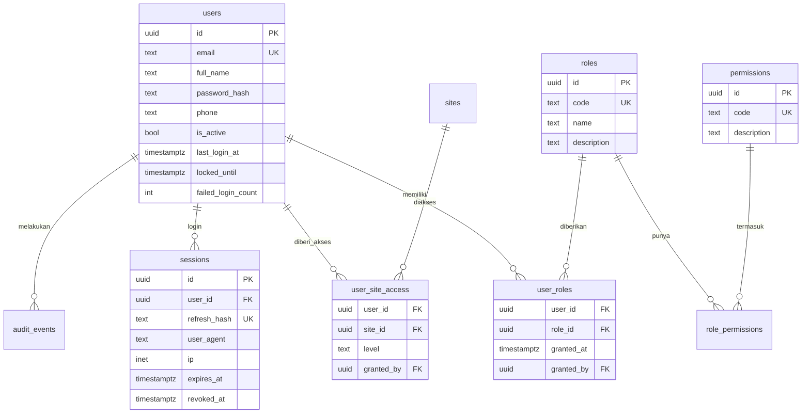
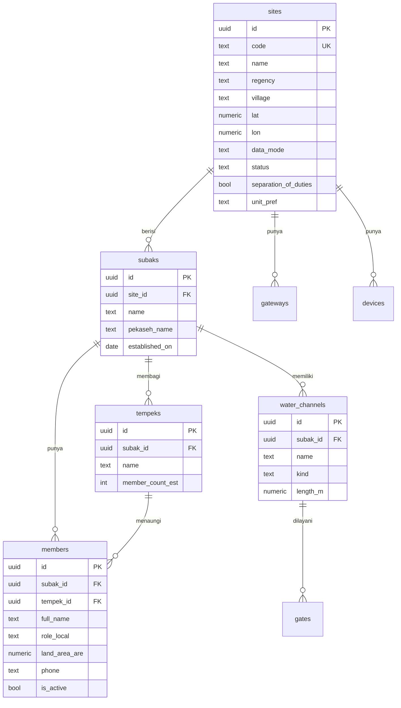
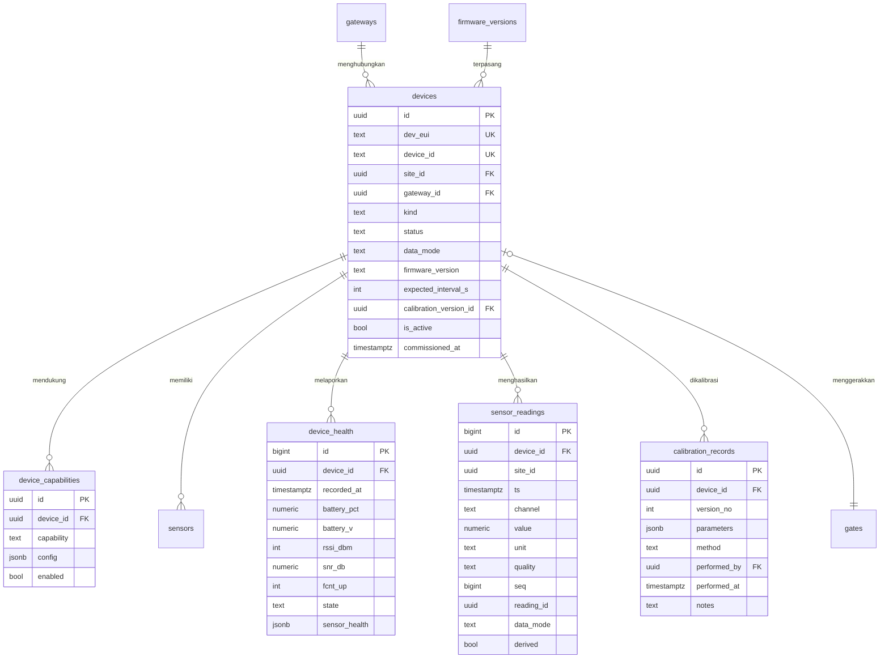
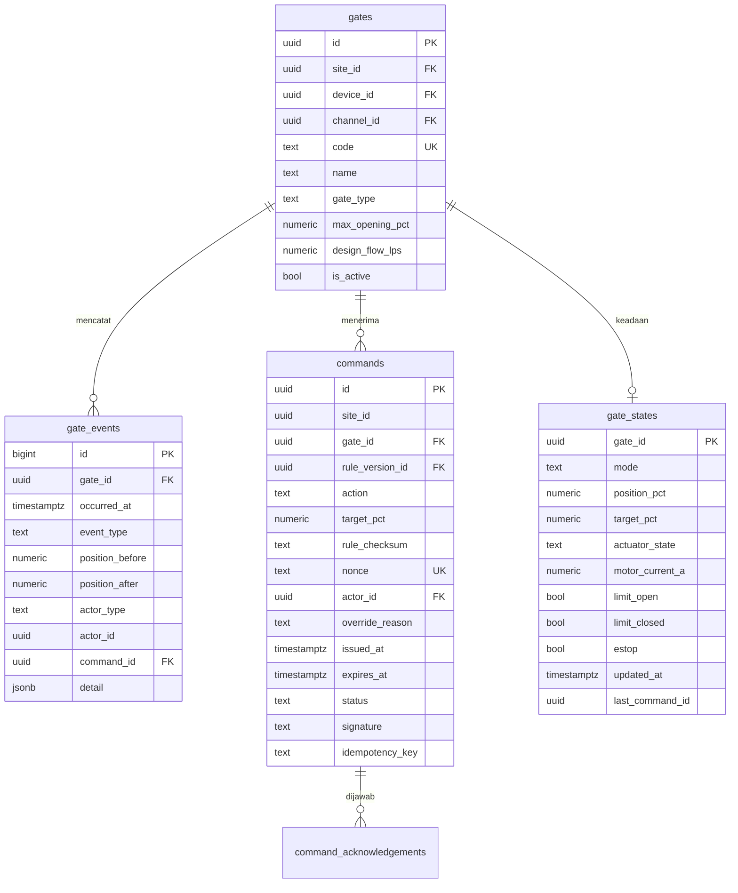
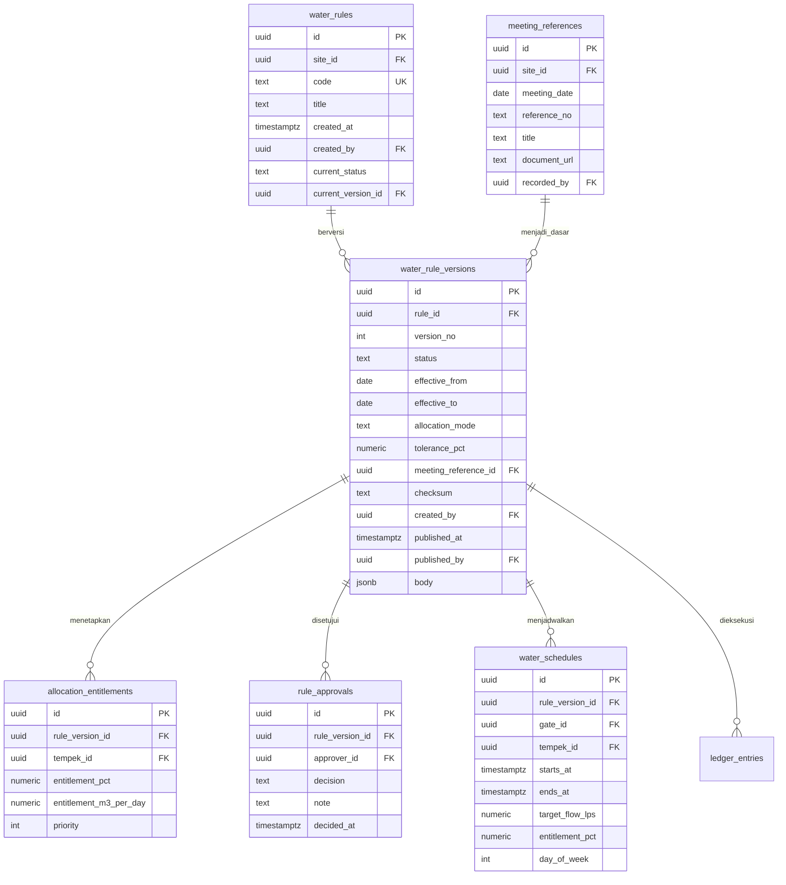
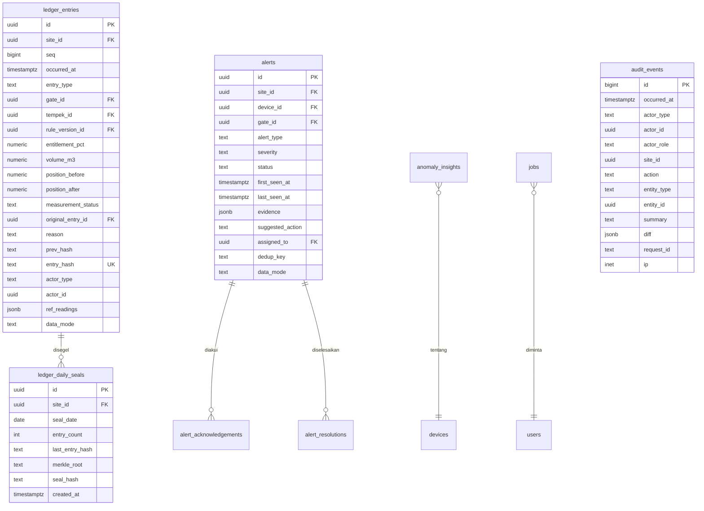

# 07 — Database Design & ERD

**PostgreSQL 16 + TimescaleDB 2.15** · Semua waktu `timestamptz` dalam UTC

---

## 1. Prinsip skema

1. **Identitas tabel:** UUIDv7 (`gen_random_uuid()` untuk v0.1, dapat diganti
   `uuid_generate_v7()` di Phase 1) pada tabel transaksional; `bigint identity` untuk
   hypertable readings.
2. **Foreign key wajib** untuk semua relasi; `ON DELETE RESTRICT` default, `CASCADE`
   hanya untuk anak yang secara konsep dimiliki induk (mis. `alert_acknowledgements`).
3. **Append-only** pada `ledger_entries`, `ledger_daily_seals`, `ledger_verification`,
   `audit_events`, `gate_events`, `rule_approvals` (trigger menolak UPDATE/DELETE).
4. **Site scope** ada di hampir semua tabel domain (`site_id`) agar filter otorisasi
   tidak memerlukan join yang mahal.
5. **Data mode** (`SIMULATION`/`LIVE`) disimpan eksplisit di `sites`, `devices`,
   `sensor_readings`, `alerts`, `ledger_entries`, `reports` — bukan disimpulkan dari
   nama device.
6. **Soft delete** hanya `is_active` untuk entitas master; histori tidak dihapus.

---

## 2. ERD (ringkas per klaster)

### 2.1 Identity & akses



### 2.2 Subak, tempek, kanal



### 2.3 Device, gateway, telemetri



### 2.4 Gate & command



### 2.5 Rule, jadwal, entitlemen



### 2.6 Ledger, alert, audit, job



---

## 3. DDL inti

### 3.1 Extensions & tipe

```sql
CREATE EXTENSION IF NOT EXISTS "pgcrypto";
CREATE EXTENSION IF NOT EXISTS timescaledb;

CREATE TYPE data_mode_t   AS ENUM ('SIMULATION', 'LIVE');
CREATE TYPE gate_mode_t   AS ENUM ('AUTO', 'MANUAL', 'HOLD', 'FAULT', 'IDLE');
CREATE TYPE quality_t     AS ENUM ('OK', 'SUSPECT', 'BAD', 'MISSING');
CREATE TYPE cmd_status_t  AS ENUM ('PENDING_SIGN','SENT','ACKNOWLEDGED','EXECUTED',
                                   'REJECTED','EXPIRED','FAILED_TO_SEND','UNKNOWN','DIVERGED');
CREATE TYPE rule_status_t AS ENUM ('DRAFT','IN_REVIEW','APPROVED','PUBLISHED',
                                   'SUPERSEDED','REJECTED','EXPIRED');
CREATE TYPE severity_t    AS ENUM ('INFO','LOW','MEDIUM','HIGH','CRITICAL');
CREATE TYPE site_level_t  AS ENUM ('VIEW','OPERATE','GOVERN','ADMIN');
```

### 3.2 Identity

```sql
CREATE TABLE users (
  id                 uuid PRIMARY KEY DEFAULT gen_random_uuid(),
  email              citext UNIQUE NOT NULL,
  full_name          text NOT NULL,
  phone              text,
  password_hash      text NOT NULL,
  is_active          boolean NOT NULL DEFAULT true,
  failed_login_count integer NOT NULL DEFAULT 0,
  locked_until       timestamptz,
  last_login_at      timestamptz,
  created_at         timestamptz NOT NULL DEFAULT now(),
  updated_at         timestamptz NOT NULL DEFAULT now()
);

CREATE TABLE user_site_access (
  user_id    uuid NOT NULL REFERENCES users(id) ON DELETE CASCADE,
  site_id    uuid NOT NULL REFERENCES sites(id) ON DELETE CASCADE,
  level      site_level_t NOT NULL DEFAULT 'VIEW',
  granted_by uuid REFERENCES users(id),
  granted_at timestamptz NOT NULL DEFAULT now(),
  PRIMARY KEY (user_id, site_id)
);
CREATE INDEX ix_usa_site ON user_site_access(site_id);

CREATE TABLE sessions (
  id           uuid PRIMARY KEY DEFAULT gen_random_uuid(),
  user_id      uuid NOT NULL REFERENCES users(id) ON DELETE CASCADE,
  refresh_hash text NOT NULL UNIQUE,
  user_agent   text,
  ip           inet,
  created_at   timestamptz NOT NULL DEFAULT now(),
  expires_at   timestamptz NOT NULL,
  revoked_at   timestamptz,
  rotated_from uuid REFERENCES sessions(id)
);
CREATE INDEX ix_sessions_user_active ON sessions(user_id) WHERE revoked_at IS NULL;
```

### 3.3 Telemetri (hypertable)

```sql
CREATE TABLE telemetry_raw (
  id          bigint GENERATED ALWAYS AS IDENTITY,
  device_id   uuid NOT NULL REFERENCES devices(id),
  site_id     uuid NOT NULL,
  ts          timestamptz NOT NULL,
  seq         bigint NOT NULL,
  payload     jsonb NOT NULL,
  payload_sha text NOT NULL,
  source      text NOT NULL,          -- 'LORAWAN' | 'SIMULATOR' | 'MANUAL_ENTRY'
  data_mode   data_mode_t NOT NULL,
  received_at timestamptz NOT NULL DEFAULT now(),
  PRIMARY KEY (id, ts)
);
SELECT create_hypertable('telemetry_raw', 'ts', chunk_time_interval => INTERVAL '1 day');
CREATE UNIQUE INDEX ux_raw_device_seq ON telemetry_raw(device_id, seq, ts);

CREATE TABLE sensor_readings (
  id         bigint GENERATED ALWAYS AS IDENTITY,
  reading_id uuid NOT NULL DEFAULT gen_random_uuid(),
  device_id  uuid NOT NULL REFERENCES devices(id),
  site_id    uuid NOT NULL,
  ts         timestamptz NOT NULL,
  channel    text NOT NULL,           -- 'water_level_up','water_level_down','flow','battery',...
  value      numeric(12,4) NOT NULL,
  unit       text NOT NULL,
  quality    quality_t NOT NULL DEFAULT 'OK',
  seq        bigint NOT NULL,
  data_mode  data_mode_t NOT NULL,
  derived    boolean NOT NULL DEFAULT false,
  PRIMARY KEY (id, ts)
);
SELECT create_hypertable('sensor_readings', 'ts', chunk_time_interval => INTERVAL '1 day');
CREATE INDEX ix_readings_device_channel_ts ON sensor_readings(device_id, channel, ts DESC);
CREATE INDEX ix_readings_site_ts ON sensor_readings(site_id, ts DESC);

-- Agregat 1 menit (dipakai grafik 24 jam – 30 hari)
CREATE MATERIALIZED VIEW readings_1m
WITH (timescaledb.continuous) AS
SELECT time_bucket('1 minute', ts) AS bucket,
       device_id, channel, site_id,
       avg(value) AS avg_value, min(value) AS min_value, max(value) AS max_value,
       count(*) AS n, min(quality) AS worst_quality
FROM sensor_readings
WHERE quality <> 'BAD'
GROUP BY bucket, device_id, channel, site_id
WITH NO DATA;

SELECT add_continuous_aggregate_policy('readings_1m',
  start_offset => INTERVAL '3 days', end_offset => INTERVAL '1 minute',
  schedule_interval => INTERVAL '1 minute');

-- Retensi
SELECT add_retention_policy('telemetry_raw',  INTERVAL '90 days');
SELECT add_retention_policy('sensor_readings', INTERVAL '90 days');
SELECT add_retention_policy('readings_1m',     INTERVAL '13 months');
```

### 3.4 Rule immutability trigger

```sql
CREATE OR REPLACE FUNCTION forbid_published_version_mutation() RETURNS trigger AS $$
BEGIN
  IF OLD.status IN ('PUBLISHED','SUPERSEDED','EXPIRED') THEN
    RAISE EXCEPTION 'rule version % is immutable (status %)', OLD.id, OLD.status
      USING ERRCODE = '23514';
  END IF;
  RETURN NEW;
END $$ LANGUAGE plpgsql;

CREATE TRIGGER trg_rule_version_immutable
BEFORE UPDATE OR DELETE ON water_rule_versions
FOR EACH ROW EXECUTE FUNCTION forbid_published_version_mutation();
```
(Pengecualian: transisi status `PUBLISHED → SUPERSEDED/EXPIRED` dilakukan lewat fungsi
`SECURITY DEFINER` `advance_rule_status()` yang juga menulis audit — sehingga tidak
dapat dipakai untuk mengubah isi versi.)

### 3.5 Ledger append-only

```sql
CREATE TABLE ledger_entries (
  id               uuid PRIMARY KEY DEFAULT gen_random_uuid(),
  site_id          uuid NOT NULL REFERENCES sites(id),
  seq              bigint NOT NULL,
  occurred_at      timestamptz NOT NULL,
  entry_type       text NOT NULL CHECK (entry_type IN
                     ('DISTRIBUTION','GATE_ACTIVITY','COMPENSATION','SYSTEM_NOTE')),
  gate_id          uuid REFERENCES gates(id),
  tempek_id        uuid REFERENCES tempeks(id),
  rule_version_id  uuid REFERENCES water_rule_versions(id),
  entitlement_pct  numeric(6,2),
  volume_m3        numeric(12,3),
  position_before  numeric(6,2),
  position_after   numeric(6,2),
  measurement_status text NOT NULL DEFAULT 'MEASURED'
                     CHECK (measurement_status IN ('MEASURED','ESTIMATED','MISSING')),
  original_entry_id uuid REFERENCES ledger_entries(id),
  reason           text,
  prev_hash        text,
  entry_hash       text NOT NULL UNIQUE,
  actor_type       text NOT NULL CHECK (actor_type IN ('USER','DEVICE','SYSTEM')),
  actor_id         uuid,
  ref_readings     jsonb,
  data_mode        data_mode_t NOT NULL,
  created_at       timestamptz NOT NULL DEFAULT now(),
  CONSTRAINT ux_ledger_site_seq UNIQUE (site_id, seq),
  CONSTRAINT ck_compensation CHECK (
    entry_type <> 'COMPENSATION' OR (original_entry_id IS NOT NULL AND length(reason) >= 20))
);

CREATE OR REPLACE FUNCTION forbid_ledger_mutation() RETURNS trigger AS $$
BEGIN
  RAISE EXCEPTION 'ledger_entries is append-only';
END $$ LANGUAGE plpgsql;

CREATE TRIGGER trg_ledger_no_update BEFORE UPDATE ON ledger_entries
FOR EACH ROW EXECUTE FUNCTION forbid_ledger_mutation();
CREATE TRIGGER trg_ledger_no_delete BEFORE DELETE ON ledger_entries
FOR EACH ROW EXECUTE FUNCTION forbid_ledger_mutation();
```

### 3.6 Command & nonce

```sql
CREATE TABLE commands (
  id               uuid PRIMARY KEY DEFAULT gen_random_uuid(),
  site_id          uuid NOT NULL,
  gate_id          uuid NOT NULL REFERENCES gates(id),
  rule_version_id  uuid REFERENCES water_rule_versions(id),
  action           text NOT NULL CHECK (action IN ('SET_POSITION','OPEN','CLOSE','HOLD','RELEASE_HOLD')),
  target_pct       numeric(6,2),
  rule_checksum    text,
  nonce            uuid NOT NULL UNIQUE,
  actor_id         uuid NOT NULL REFERENCES users(id),
  override_reason  text,
  issued_at        timestamptz NOT NULL DEFAULT now(),
  expires_at       timestamptz NOT NULL,
  status           cmd_status_t NOT NULL DEFAULT 'PENDING_SIGN',
  signature        text,
  idempotency_key  text,
  failure_reason   text,
  CONSTRAINT ck_cmd_pct CHECK (target_pct IS NULL OR target_pct BETWEEN 0 AND 100),
  CONSTRAINT ck_cmd_window CHECK (expires_at > issued_at AND expires_at <= issued_at + INTERVAL '120 seconds'),
  UNIQUE (actor_id, idempotency_key)
);
-- Hanya boleh satu command aktif per gate
CREATE UNIQUE INDEX ux_cmd_one_inflight ON commands(gate_id)
  WHERE status IN ('PENDING_SIGN','SENT','ACKNOWLEDGED');
```

---

## 4. Index & performa

| Tabel | Index | Alasan |
|---|---|---|
| `sensor_readings` | `(device_id, channel, ts DESC)` | grafik & latest |
| `sensor_readings` | `(site_id, ts DESC)` | dashboard pemakaian |
| `telemetry_raw` | unique `(device_id, seq, ts)` | idempotency |
| `gate_events` | `(gate_id, occurred_at DESC)` | riwayat gate |
| `commands` | `(gate_id, issued_at DESC)`, unique partial in-flight | keamanan & riwayat |
| `ledger_entries` | unique `(site_id, seq)`, `(site_id, occurred_at DESC)` | verifikasi & daftar |
| `alerts` | `(site_id, status, severity)`, unique `(dedup_key) WHERE status='OPEN'` | daftar kerja |
| `audit_events` | `(occurred_at DESC)`, `(entity_type, entity_id)` | penelusuran |
| `user_site_access` | `(user_id)` PK, `(site_id)` | scope |
| `devices` | unique `dev_eui`, `(site_id, kind)` | provisioning |

`readings_1m` menangani grafik 24 jam–30 hari; data harian/bulanan memakai
`time_bucket('1 hour')` di query atau continuous aggregate kedua (`readings_1h`).

---

## 5. Integritas & konsistensi

| Risiko | Kontrol |
|---|---|
| Telemetri ganda | unique `(device_id, seq)` + `ON CONFLICT DO NOTHING` |
| Ledger bercabang | unique `(site_id, seq)` + `SELECT ... FOR UPDATE` pada `site_ledger_counter` |
| Dua command aktif | partial unique index `ux_cmd_one_inflight` |
| Rule aktif berubah | trigger immutability + hanya insert versi baru |
| Audit dihapus | trigger `no_update`/`no_delete` |
| Gate tanpa device | `gates.device_id` nullable (gate bisa belum terpasang), `gate_states` tetap ada |
| Device pindah gate | riwayat di `device_assignments` (Phase 1: kolom `assigned_at`) |
| Zona waktu salah | semua `timestamptz`, `SET TIME ZONE 'UTC'` pada sesi aplikasi |

---

## 6. Backup, restore, retensi

```bash
# Backup harian (compose service: db-backup)
pg_dump -Fc --no-owner --dbname="$DATABASE_URL" -f /backup/subako-$(date +%F).dump
pg_dump -Fc --schema-only --dbname="$DATABASE_URL" -f /backup/subako-schema-$(date +%F).dump

# Restore ke lingkungan bersih
createdb subako_restore
pg_restore -d subako_restore --no-owner /backup/subako-YYYY-MM-DD.dump
```

Prosedur lengkap (termasuk drill kuartalan, verifikasi hash ledger setelah restore, dan
RPO/RTO) ada di Phase 7 deliverable *Deployment Guide*; ringkasan target ada di
`01-system-architecture.md` §8.

Retensi:

| Data | Retensi | Metode |
|---|---|---|
| `telemetry_raw` | 90 hari | Timescale retention policy |
| `sensor_readings` | 90 hari | Timescale retention policy |
| `readings_1m` | 13 bulan | Timescale retention policy |
| `readings_1h` | 5 tahun | Timescale retention policy |
| `ledger_entries`, `audit_events`, `gate_events` | **permanen** (pilot) | arsip tahunan ke object storage |
| `telemetry_rejections` | 180 hari | job harian |
| `sessions` kedaluwarsa | 30 hari setelah expires | job cleanup |

---

## 7. Seed & data demo

Seed (`backend/app/db/seed.py` + `infra/seed/`) membuat:

| Entitas | Jumlah | Catatan |
|---|---|---|
| Site | 2 | `SUBAK-DEMO-01` (SIMULATION), `SUBAK-PILOT` (LIVE, tanpa device — kosong) |
| Subak / tempek | 2 / 4 | nama Bali realistis untuk demo |
| Gate | 6 | 4 di DEMO, 2 pilot (unprovisioned) |
| Node ukur | 8 | level hulu/hilir |
| Gateway | 2 | 1 online, 1 offline (skenario) |
| Rule | 2 | 1 published, 1 draft in-review |
| Ledger | ± 120 entri | 7 hari terakhir, hash chain valid |
| Alerts | 6 | satu per severity, 2 resolved |
| Users | 6 | `admin@mikiko.id`, `pekaseh@demo`, `operator@demo`, `petani@demo`, + 2 nonaktif |

Semua password demo `Subako#2026` **hanya** untuk environment `development`, dan seed
menolak berjalan bila `APP_ENV=production`. Setiap baris data demo memakai
`data_mode='SIMULATION'`.

---

## 8. Migrasi (Alembic)

- Satu direktori migrasi, satu head. Nama file: `YYYYMMDDHHMM_slug.py`.
- `env.py` memakai metadata yang sama dengan model; `--autogenerate` hanya di lokal,
  review manual sebelum commit.
- Migrasi destruktif (drop column/table) wajib dua langkah: (1) tandai deprecated +
  backfill, (2) drop pada rilis berikutnya.
- Migrasi Timescale (hypertable, policy) ditulis manual dalam migrasi khusus karena
  autogenerate tidak menanganinya.
- `alembic upgrade head` adalah langkah wajib pada entrypoint container sebelum start
  (dengan advisory lock agar aman bila container restart).
