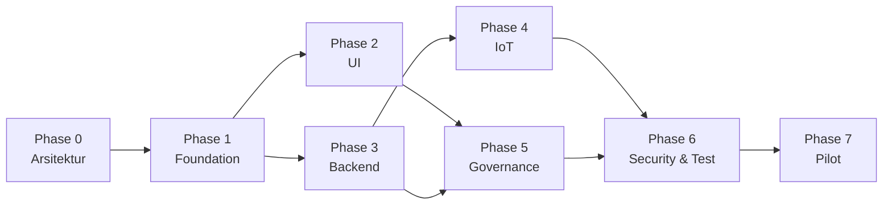

# 10 — Development Roadmap & Estimasi

**SUBAKO Web-PWA v0.1** · 7 fase sesuai Pasal 19 · Asumsi sprint 2 minggu

---

## 1. Asumsi perencanaan

| Asumsi | Nilai | Dampak bila berubah |
|---|---|---|
| Tim inti | 4 orang: 1 backend, 1 frontend, 1 full-stack/IoT, 0.5 UI/UX, 0.5 QA/DevOps | Tim 3 orang → +25% durasi |
| Kapasitas | 32 jam/orang/minggu (bukan 40, untuk review & bugfix) | — |
| Ketersediaan SME Subak | 2 sesi × 2 jam per sprint | Tanpa SME, rule model berisiko salah |
| Hardware siap uji | **Tidak** di v0.1 (simulator) | Integrasi hardware menambah Phase 3.5 |
| Deployment pilot | 1 host Docker Compose, ≤ 12 node | Multi-host → +2 minggu |
| Definisi selesai | Kode + test + docs + review lulus | — |

**Total estimasi v0.1 (Phase 1–6): 15 minggu kalender, ~58 person-week.**
Phase 7 (pilot) bergantung kesiapan hardware dan berjalan paralel dengan persiapan
lapangan.

---

## 2. Ringkasan fase

| Fase | Fokus | Durasi | Person-week | Gate review |
|---|---|---|---|---|
| 0 | Paket arsitektur (dokumen ini) | 2 minggu | 6 | **PO sign-off** |
| 1 | Project Foundation | 3 minggu | 12 | Sistem dasar jalan |
| 2 | UI/UX Implementation | 3 minggu | 10 | Demo visual + data simulasi |
| 3 | Backend Development | 4 minggu | 16 | API lengkap + test |
| 4 | IoT Integration | 2 minggu (paralel dengan 3) | 6 | Telemetri end-to-end |
| 5 | Water Governance | 2 minggu (setelah 3) | 8 | Rule + ledger + audit |
| 6 | Security & Testing | 2 minggu | 8 | Staging release |
| 7 | Pilot Preparation | 4+ minggu | 10+ | Commissioning |

Fase 4 dimulai paralel dengan fase 3 karena bridge dan simulator hanya bergantung pada
kontrak payload (sudah dibekukan di `06-backend-architecture.md` §5.3), bukan pada
seluruh API.

---

## 3. Detail per fase

### Phase 0 — Architecture Package (sekarang)

**Output:** 10 deliverable + open decisions.

**Exit criteria:**
- [ ] Checklist `00-paket-arsitektur.md` §6 ditandatangani.
- [ ] Tidak ada keputusan `BLOCKING` terbuka.
- [ ] Tanggal gate review Phase 1 disepakati.

---

### Phase 1 — Project Foundation (3 minggu, 12 pw)

| Minggu | Backend | Frontend | Infra |
|---|---|---|---|
| 1 | Skeleton FastAPI, settings, logging, error handler, `/healthz` | Skeleton Vite + TS + Tailwind token, AppShell, routing guard | Compose: db, api, fe, mqtt; `.env.example`; README dev |
| 2 | Alembic init, model identity + sites, auth (login/refresh/logout), `require()` | Login page, AuthProvider, token store, refresh single-flight | Seed dasar, Makefile, lint/format CI |
| 3 | RBAC matrix → seed roles/permissions; site scope; `GET /auth/me` | Layout responsif (sidebar/bottom nav), 403/404, error boundary | CI: lint, typecheck, test; pre-commit |

**Deliverables:** repo jalan `docker compose up`, login demo, RBAC aktif di backend,
CI hijau.

**Exit criteria:** 4 role dapat login; endpoint terproteksi mengembalikan 403 untuk role
yang salah (test otomatis); tidak ada secret di repo.

**Risiko:** pengaturan awal Timescale/ChirpStack memakan waktu → mitigasi: ChirpStack
opsional di Phase 1, bridge mode `--simulate`.

---

### Phase 2 — UI/UX Implementation (3 minggu, 10 pw)

| Minggu | Output |
|---|---|
| 4 | Komponen UI inti (`KpiCard`, `StatusPill`, `DataTable`, `ChartCard`, `EmptyState`), Dashboard dengan data mock MSW |
| 5 | Monitoring: peta (Leaflet + GeoJSON), water level, flow, device health; filter global |
| 6 | Gate list + gate detail (5 state panel), Alerts, Ledger, Rules, Reports (kerangka) |

**Deliverables:** seluruh 22 rute ada, responsif 3 breakpoint, prototipe desain
diimplementasikan 1:1, MSW mock untuk semua endpoint.

**Exit criteria:** Lighthouse PWA ≥ 90 installable; tidak ada layout shift > 0,1;
axe-core 0 violation serius; screenshot 3 viewport untuk setiap halaman utama.

---

### Phase 3 — Backend Development (4 minggu, 16 pw)

| Minggu | Output |
|---|---|
| 7 | Model + migrasi lengkap (identity, sites, devices, telemetry), seed |
| 8 | Telemetri: ingest internal, dedup, freshness, history, agregat; gate state; events |
| 9 | Command service (9 lapis), HMAC, nonce, MQTT publish, ACK ingest; WebSocket manager |
| 10 | Alerts, reports (query + ekspor PDF/Excel via worker), admin users, audit, system health |

**Deliverables:** OpenAPI sesuai `08-api-specification.md`; test coverage backend ≥ 80%
pada service kritis; Postman/HTTPie collection.

**Exit criteria:** semua endpoint pada katalog §2 ada dan teruji; matriks otorisasi
(16 skenario) hijau; ingest 100×50 readings < 2 s; riwayat 24 jam < 800 ms.

---

### Phase 4 — IoT Integration (2 minggu, 6 pw, paralel)

| Minggu | Output |
|---|---|
| 8 | Mosquitto config + ACL + TLS dev; ChirpStack v4 di compose; bridge Python (sub → HTTP), retry/backoff |
| 9 | Device simulator CLI: normal, sensor error, offline, low battery, overcurrent, encoder mismatch, comm failure; skenario command + ACK |

**Deliverables:** simulator yang dapat menjalankan skenario via perintah
(`simulator run --scenario low_battery --device SIM-GATE-01`), dokumentasi topic & ACL,
bukti dashboard menerima update.

**Exit criteria:** 7 skenario simulator menghasilkan alert/state yang benar; tidak ada
kredensial MQTT di bundle frontend (dicek dengan grep pada build); command simulasi
sampai ACK tercatat di ledger.

---

### Phase 5 — Water Governance (2 minggu, 8 pw)

| Minggu | Output |
|---|---|
| 11 | Rule registry + versi + approval + publish + trigger immutability; referensi Paruman; jadwal |
| 12 | Ledger writer (hash chain), verifikasi, seal harian, kompensasi, ekspor; laporan deviasi |

**Exit criteria:** uji tamper (UPDATE langsung di DB) → verifikasi gagal dan alert;
edit rule published → 409; publish tanpa approval → 409; SOE ditegakkan; ekspor ledger
memuat potongan hash chain.

---

### Phase 6 — Security & Testing (2 minggu, 8 pw)

| Area | Aktivitas |
|---|---|
| Security review | Threat model STRIDE, dependency audit (`pip-audit`, `npm audit`), secret scan (gitleaks), CSP & header hardening |
| Pen-test internal | Otorisasi (16 skenario), IDOR, rate limit, JWT reuse, MQTT ACL (coba publish lintas topic) |
| Offline/PWA | Uji offline, reconnect, tidak ada command terkirim saat kembali online |
| Performance | Locust: 50 user, 3 site, ingest 60 s; ukur p95 |
| Backup/restore | Drill: dump → restore → verify ledger → bandingkan hash |
| Dokumentasi | User manual, deployment guide, troubleshooting, testing report |

**Exit criteria:** 0 temuan kritis/tinggi terbuka; semua skenario safety §17.4 lulus;
dokumen operasional lengkap; staging release diberi tag `v0.1.0-rc1`.

---

### Phase 7 — Pilot Preparation (4+ minggu, 10+ pw)

| Aktivitas | Prasyarat |
|---|---|
| Konfigurasi site pilot, tempek, kanal, gate | Data survei |
| Provisioning device + kalibrasi per titik | Hardware terpasang, akses lapangan |
| Integrasi hardware & commissioning | E-STOP, limit switch, handwheel teruji fisik |
| Pelatihan operator & Pekaseh (2 sesi) | Manual pengguna final |
| Pendampingan minggu 1–2 | Dukungan on-call |

**Exit criteria pilot:** 7 hari berturut-turut uptime ≥ 99%, tidak ada command yang
dikirim tanpa ACK tercatat, ledger terverifikasi harian, Pekaseh dapat membuat dan
mempublikasikan minimal 1 rule nyata.

---

## 4. Urutan kerja & dependensi

Jalur kritis: **P1 → P3 → P5 → P6**. UI (P2) dan IoT (P4) memiliki slack 1 minggu;
keterlambatan pada P3 langsung menggeser seluruh jadwal.

---

## 5. Pembagian kerja

| Peran | Fokus utama | Fokus sekunder |
|---|---|---|
| Backend Engineer | Telemetri, command, ledger, RBAC | Integrasi MQTT, worker |
| Frontend Engineer | AppShell, dashboard, gate detail, PWA | Chart, aksesibilitas |
| Full-stack / IoT | Bridge, simulator, provisioning | API admin, deployment |
| UI/UX Designer | Design system, prototipe, QA visual | User manual (visual) |
| QA & Security | Test plan, otorisasi, PWA offline, pen-test | Testing report |
| DevOps | Compose, CI, backup, observability | Hardening |

---

## 6. Estimasi per deliverable wajib (Pasal 21)

| # | Deliverable | Fase | Status |
|---|---|---|---|
| 1 | Source code frontend | 1–5 | — |
| 2 | Source code backend | 1–5 | — |
| 3 | Schema & migration | 3 | — |
| 4 | Docker Compose | 1 | — |
| 5 | API documentation | 0 (spec), 3 (live) | **spec tersedia** |
| 6 | UI component library | 2 | **prototipe tersedia** |
| 7 | Device simulator | 4 | — |
| 8 | MQTT integration | 4 | — |
| 9 | Seed & demo account | 1, 3 | — |
| 10 | Testing report | 6 | — |
| 11 | Deployment guide | 6 | — |
| 12 | Architecture diagram | 0 | **tersedia** |
| 13 | User manual | 6 | — |
| 14 | Technical documentation | 0–6 | **sebagian** |
| 15 | Release notes | 6 | — |

---

## 7. Risiko & mitigasi

| # | Risiko | P | D | Mitigasi |
|---|---|---|---|---|
| R1 | Parameter hardware berubah (sensor/motor/encoder) | Tinggi | Sedang | Capability-driven design; payload additive; tidak ada kolom yang mengunci tipe aktuator |
| R2 | Rule model tidak sesuai praktik Subak | Sedang | Tinggi | Workshop SME 2× per sprint; rule `body` disimpan fleksibel (jsonb) + entitlement terstruktur |
| R3 | Koneksi lapangan buruk | Tinggi | Sedang | PWA offline read, payload kecil, interval 60 s, tidak ada aset berat |
| R4 | Kesalahan operasional (command salah) | Sedang | Tinggi | Konfirmasi ketik, TTL 90 s, single in-flight, tidak ada bulk action |
| R5 | Lingkup melebar (AI, billing, mobile) | Tinggi | Sedang | Daftar "di luar lingkup" di `00` §4 ditegakkan; perubahan lewat change request |
| R6 | Data pribadi anggota | Sedang | Sedang | Minimalisasi data; enkripsi backup; akses dibatasi; lihat K-11 |
| R7 | Ketergantungan satu orang (bus factor) | Sedang | Tinggi | Pair review wajib, dokumentasi keputusan (ADR), handover session |
| R8 | Integrasi ChirpStack berubah antar versi | Sedang | Rendah | Isolasi di bridge; pin versi image; test kontrak MQTT |

---

## 8. Definisi selesai (v0.1)

v0.1 dinyatakan selesai bila seluruh Acceptance Criteria Pasal 20 terpenuhi **dan**:

- [ ] Semua 16 skenario otorisasi lulus otomatis.
- [ ] Semua 10 skenario safety (Pasal 17.4) lulus otomatis atau terdokumentasi manual.
- [ ] Ledger terverifikasi pada data demo 7 hari dan pada data hasil restore backup.
- [ ] PWA installable dan menampilkan state offline dengan timestamp.
- [ ] Dokumentasi: API, deployment, user manual, troubleshooting, testing report.
- [ ] Tidak ada `TODO`/`FIXME` di jalur kritis (grep di CI).
- [ ] Tidak ada secret di repo (gitleaks hijau).

---

## 9. Setelah v0.1

| Kandidat | Prasyarat |
|---|---|
| Analytics lanjutan (drift detection) | ≥ 3 bulan data lapangan bersih |
| Delegasi peran sementara | Kebutuhan Pekaseh terverifikasi |
| Multi-node HA | Jumlah site > 5 atau SLA naik |
| Replikasi ke Subak lain (self-service onboarding) | Template site + wizard provisioning |
| Integrasi GIS resmi | Ketersediaan data batas Subak |
